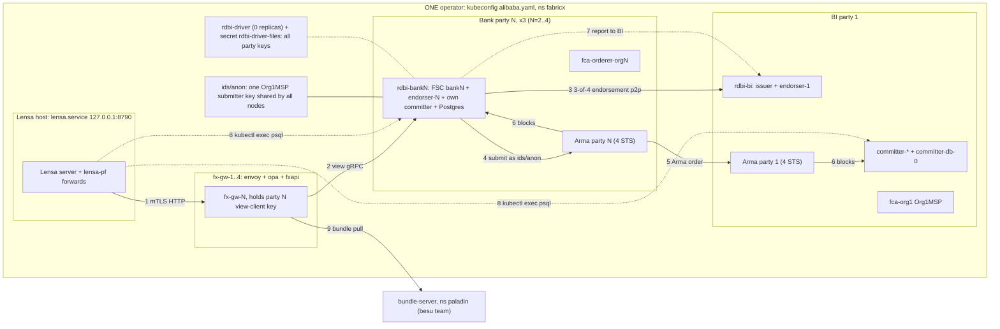
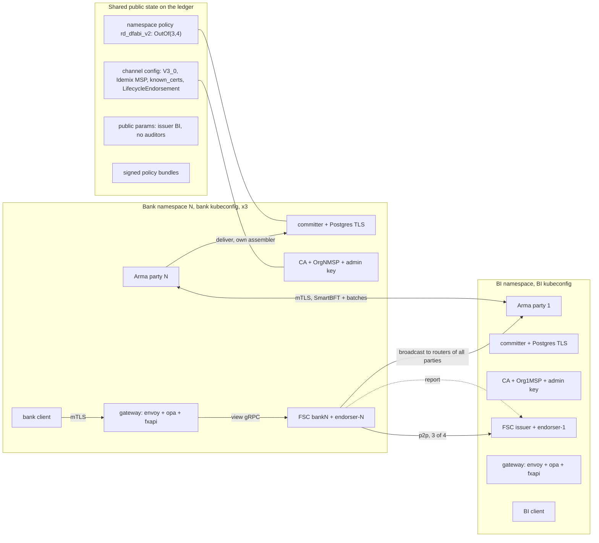
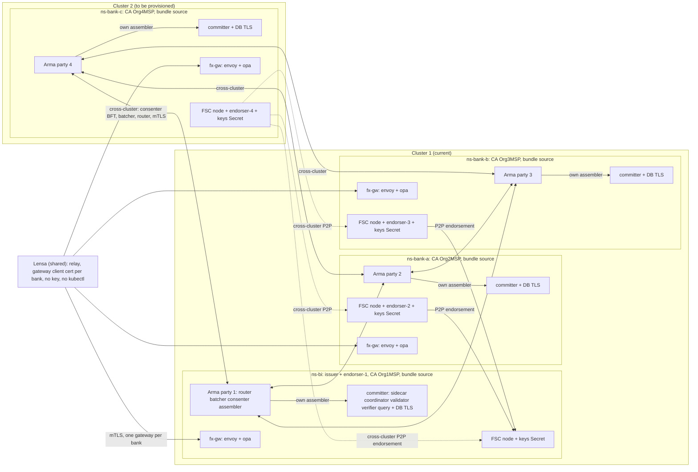

# ARCHITECTURE-fabricx

Date 2026-11-11. Read-only research. Pins: fabric-x@3f7caeb, frontend@aa6e09b, committer v1.0.4 (08a469d), orderer v1.0.4 (dd296e3), Panurus v0.24.0 (5f3c49e2 + 4 project patches in the working tree), FSC v0.24.0 (module cache absent: "not opened"), Ansible collection hyperledger.fabricx 0.8.26.
Notation: `committer:` = fabric-x-committer@08a469d, `orderer:` = fabric-x-orderer@dd296e3, `panurus:` = .../panurus-itest/.work/panurus. Line numbers were read in this session; Panurus `ttx/collectendorsements.go` is a patched file, so its lines are the checkout's, not upstream's. Panurus and FSC patches stay (accepted); no new custom code is proposed.

## 1. BEFORE (today)

One operator, one cluster-admin kubeconfig (`alibaba.yaml`), one namespace `fabricx`. Multiregion namespaces are outside the Lensa path (see 2.4).

| # | Box / arrow | Source |
|---|---|---|
| 1 | Lensa to fx-gw over mTLS HTTP on 127.0.0.1:39440+node via port-forward | frontend@aa6e09b:server/src/adapters/fabricx.ts:99 (`fxGateway`) |
| 1 | Lensa host service, one kubeconfig for the namespace | fabricx.ts:74-77 (`kubectl --kubeconfig`), :445 (`FABRICX_KUBECONFIG`); lensa.service per memory, not re-checked |
| 2 | fx-gw = envoy + OPA ext_authz + fxapi `driver serve`, own party key only | fabric-x@3f7caeb:opa/DESIGN.md:29-45; live `kubectl get deploy fx-gw-1 -n fabricx` (3/3 pods fx-gw-1..4) |
| 3 | 3-of-4 policy `OutOf(3, Org1..4MSP.member)`; one endorser per org | panurus-itest/rdbi/topology.go:70-76, :84; live `kubectl get svc -n fabricx` endorser-1..4 |
| 3 | Endorser failover / sequential signatures are project patches | panurus-itest/patches/panurus-endorser-failover.patch, panurus-sequential-remote-signatures.patch; README.md:124-131 |
| 4 | Shared submitter identity `ids/anon` (Org1MSP) for every ledger tx | panurus-itest/README.md:118-121 (deviation 2) |
| 4 | Full certificate instead of certificate-ID (FSC patch) | patches/fsc-full-certificate.patch; README.md:115-117 (deviation 1) |
| 5 | Arma: 4 parties, one STS per role per party; images unmodified 1.0.4 | live `kubectl get sts orderer-router-1 -n fabricx` (image fabric-x-orderer:1.0.4); orderer:docs/architecture.md:30 |
| 6 | Bank committer in the bank pod: verifier, vc, coordinator, sidecar, query, db | live `kubectl get deploy rdbi-bank2 -n fabricx` (containers bank2 endorser-2 committer-* db); README.md:56-58 |
| 6 | Bank committer Postgres without TLS | multiorg/committer/config/vc.yaml:1-2; README.md:140-141 |
| 6 | BI committer, shared `committer-db-0` | live `kubectl get deploy -n fabricx` committer-{coordinator,validator,verifier,query-service}, sts committer-sidecar-0 |
| 7 | Report: bank sends BI the full token request after finality, detective only | README.md:32-48; panurus-itest/rdbi/report/report.go |
| 7 | BI offline: submit about 2m10s + report about 2m10s; redelivery is operator-run | opa/DESIGN.md:145-150; agents/analyst/reports/2026-11-11-iroha3-driver-fabricx-bi-down.md finding 1 |
| 8 | Lensa reads ledger by `kubectl exec ... psql` in committer-db-0 and rdbi-bankN `-c db`; `exec deploy/rdbi-driver` as fallback | fabricx.ts:155,174,283-284 |
| 9 | Policy bundles from bundle-server in ns paladin | opa/DESIGN.md:96-103; live `kubectl get deploy bundle-server -n paladin` |
| - | Secret holding every party's view-client key; Deployment kept at 0 | live `kubectl get deploy rdbi-driver -n fabricx` (0/0); secret `rdbi-driver-files`; opa/DESIGN.md:141-143 |
| - | CA and orderer keys as Secrets in one ns | live `kubectl get secret -n fabricx` (names only): fca-orderer-org{1..4}, fca-org1, orderer-*-N-secret, rdbi-*-files, fx-gw-N-files |
| - | Netpol only for rdbi-* ingress; none for orderer or committer pods | live `kubectl get netpol -n fabricx` (rdbi-bank2/3/4/bi-ingress) |
| - | Bank pods and 4 orderer pods on one node (snapshot 2026-11-11 07:19Z) | live `kubectl get pods -n fabricx -o wide`: rdbi-bank2/3/4, orderer-consenter-2/4, batcher-3, router-4 on member-16045-node |
| - | rdbi-bi replicas changed during this session (0/0 at 07:19Z, 1/1 at 07:22Z): other sessions operate it | live `kubectl get deploy rdbi-bi -n fabricx` |

## 2. AFTER (target)

Each institution (BI + 3 banks) runs its own stack in its own namespace (cluster 1 BI/A/B, cluster 2 C, see 2a) with its own kubeconfig. Shared items are public data or on-ledger objects.

### 2.1 Components, settings, upstream basis

| Box / arrow / setting | Target | Upstream citation |
|---|---|---|
| Arma party per org | One party (router, batcher, consenter, assembler) per org; party is the failure unit and an administrative unit | orderer:docs/architecture.md:178-180 |
| Fault tolerance | N=4 parties tolerate F=1 (N>=3F+1); production recommendation 7 | orderer:docs/architecture.md:182-185 |
| Party deployment | Roles on separate hosts/VMs or one party per VM; one config file per node | orderer:deployment/README.md:3-5,13-14,44-61 |
| Party key generation | `armageddon generate` creates crypto for all parties in one run (central). Each org must create its own keys and hand only public material to the others. A per-party flow is NOT found in the docs read; `createSharedConfigProto` / `createBlock` build the genesis from `shared_config.yaml` | orderer:cmd/armageddon/README.md:27-91, :237-281 |
| Same genesis everywhere | All nodes must start from identical genesis/config; operators distribute it | orderer:docs/architecture.md:148-153 |
| TLS between parties | Production: TLS/mTLS on all nodes; internal batcher/consenter services only inter-party | orderer:docs/architecture.md:187,195; deployment/README.md:34-38 (`--useTLS`) |
| Client submit | Submit to routers of all parties (stop after 2F+1); a single trusted party is discouraged (censorship) | orderer:README.md:63-64; docs/architecture.md:106 |
| Committer per org | Own sidecar, coordinator, verifier, vc, query + DB. Reads blocks from the assembler of its own party. Sidecar and coordinator are single-instance per deployment. Per-org committer is not prescribed in the docs read (reference topology = one committer behind an external orderer) | orderer:README.md:66; committer:docs/deployment-guide.md:36-40,103-104,132-134 |
| Committer TLS | `mtls` between services; orderer client TLS with per-org TLS root CAs (`orderer.organizations`); DB `tls.mode: tls` with `ca-cert-path` | committer:docs/tls-configurations.md:17-28,81-95,129-136 |
| CA / MSP per org | Own Fabric CA and MSP per org; Ansible collection generates all orgs from one control node (not per-org custody); per-org CA custody is a deployment rule of ours | hyperledger.fabricx 0.8.26 examples/playbooks/20-generate-crypto.yaml, 95-fetch-crypto.yaml (central); per-org rule: not found upstream |
| Idemix MSP for the ledger creator | Channel config gains an Idemix MSP; FSC `idemix` label then maps to it, dropping `ids/anon`. Upstream Panurus integration enables Idemix on the fabricx backend. Whether committer 1.0.4 + FSC 0.24.0 accept it live is UNVERIFIED (no Idemix in committer Go code; MSP code is fabric-x-common, not opened) | panurus:integration/token/fungible/topology/topology.go:51-53; panurus-itest/rdbi/topology.go:46; configtx template `roles/configtxgen/templates/configtx.yaml.j2:84-86` (`MSPType: idemix`); README.md:118-121 |
| known_certs (drops fsc-full-certificate) | Each org lists its FSC/endorser certs in `FabricMSPConfig.known_certs` (field 12); verifier resolves `certificate_id` from it, unknown id fails | committer:docs/namespace-policy.md:320-331; docs/verification-service.md:198-215,234 |
| Config update path | `cfgupdate build/verify` exists for channels with capabilities but only adds orgs and LifecycleEndorsement; it writes no Idemix MSP or known_certs. Official route: re-genesis with `msp/knowncerts/` (Ansible `roles/committer/tasks/crypto/fetch.yaml:10-13`) or `configtxlator compute_update` (role exists; Fabric-X MSP fields support UNVERIFIED) | multiorg/cfgupdate/main.go:1-21,111-130,132; roles/configtxlator/meta/argument_specs.yaml:13,190 |
| Capabilities | Channel V3_0, Orderer V2_0, Application V2_5 (live since 2026-11-01 reset) | multiorg/cfgupdate/main.go:132; README.md:103-111; orderer sample configtx.yaml:227-229 |
| Admin separation | Each org holds its own admin key; channel changes need a MAJORITY of org admins (checked offline for 4 orgs) | multiorg/cfgupdate/main.go (`check-genesis`, "not satisfied by Org1 admin alone"); org-level `mod_policy` per org in Fabric-X: UNVERIFIED |
| FSC node + endorser per org | One endorser per org in that org's pod; static P2P routing table lists the other orgs' addresses (today rewritten to in-cluster names) | panurus:integration/token/fungible/topology/topology.go:164-186; panurus-itest/scripts/k8s.py:74-75; FSC routing docs: not opened |
| Namespace policy | `OutOf(3, Org1..4MSP.member)`. Rule k = N - F = 2F+1 (4 orgs: 3; 7 orgs: 5). Upstream states no recommended k, only the syntax and a "2 out of 3" example. Derivation (ours): liveness with one party down needs k <= N-1; safety against F=1 Byzantine needs 2k-N >= F+1, so k >= 3 | committer:docs/namespace-policy.md:160-161,254-264; orderer:docs/architecture.md:182; topology.go:84 |
| Lifecycle policy | Namespace/config-lifecycle uses a channel-level ImplicitMeta policy; upstream sample `MAJORITY Endorsement`; ours is 4-of-4, so one org down blocks lifecycle changes (not transfers) | committer:docs/namespace-policy.md:283-289; orderer:testutil/fabric/sampleconfig/configtx.yaml:227-229; cfgupdate/main.go:123 |
| Public params | Issuer = BI (`IssuerIDs`); no auditors (see 2.3). Owner pseudonyms from one Idemix issuer key in the PP (`Setup` takes one key; the struct holds a list, >=1 required; per-bank issuers UNVERIFIED) | panurus:token/core/zkatdlog/nogh/v1/setup/setup.go:254-260,293-296,331-333,692-696 |
| Gateway per org | Own envoy + OPA + fxapi in the org's cluster; trusts only the org's client CA; party key = that org only | fabric-x@3f7caeb:opa/DESIGN.md:29-45,105-109 (our design, kept) |
| Bundle policy | Signed bundles per org (bi, bank-a/b/c) pulled over TLS; each org holds its own signing key; bundle source reachable by every gateway | opa/DESIGN.md:96-103; besu/opa signing per agents/analyst/reports/2026-11-11-opa.md |
| Own client / kubeconfig | Bank client talks only to its own gateway; no `kubectl exec`, no psql through another org's cluster; ledger reads via the org's committer query service or gateway ops (`history`, `records`, `finality`) | opa/DESIGN.md:43-45; committer:docs/query-service.md (not opened); fabricx.ts:155,174,283-284 are what goes away |

### 2.2 Per-objective result

| Objective | After | Open |
|---|---|---|
| (a) validator: own party + own committer; settles with any single other party down | ALIGNED with 4 parties (F=1). BI + one bank down stays refused | Production 7 parties (orderer:docs/architecture.md:185) is out of PoC scale |
| (b) self-submit: own FSC node, keys, gateway, kubeconfig | ALIGNED once keys leave Lensa/rdbi-driver and move to org clusters | Idemix creator route UNVERIFIED live |
| (c) third-party: no mandatory party beyond upstream | Auditor-less, 3-of-4 (our choice, kept), BI issuer ACCEPTED, report-to-BI ours and detective | Issue/burn need BI |
| R1 | ALIGNED non-parties; BI detective only (hard limit 2.3) | |
| R2 | ALIGNED (not exempt): any one other party down still settles | BI-down latency about 260 s (patch-free limit) |
| R3 | ALIGNED: one tx, two actions (panurus:docs/token_sdk_usage.md section 5) | |

### 2.3 Auditor trade-off: BI preventive visibility vs R2

Facts (all in the unmodified `validator_auditing.go` and `collectendorsements.go`):
1. No auditors in PP: validator requires none and rejects any auditor signature (`panurus:token/core/common/validator_auditing.go:50-57`).
2. Auditors in PP: at least one valid auditor signature is required, else `ErrAuditorSignaturesMissing` (validator_auditing.go:59-61). BI as sole auditor therefore stops every transfer while BI is offline: R1 "BI sees all" met preventively, R2 FAIL.
3. Several auditor keys are 1-of-N, treated as one logical auditor entity; the validator "does NOT enforce N-of-N" (validator_auditing.go:27-39,65-67). Upstream has no k-of-n auditor.
4. The initiator names one auditor per transaction (`tx.Opts.Auditor`; `requestAudit` at upstream collectendorsements.go:510,517; checkout :497-526). With auditors `[BI, A, B, C]` a bank can pick its own key and satisfy the validator without BI ever seeing the request. Making the view prefer BI and fall back to a bank auditor is new custom code (barred) and is still detective in the fallback.

Best configuration under R2: auditor-less PP (current), BI as issuer keeping audit tokens (patch `panurus-issuer-keeps-audit-tokens`, upstream path authorization.go), bank reports plus reconciliation. Make it tighter without code: a scheduled `op: report` with empty TxID per bank (a gateway op or CronJob; `report.go:36-48`, `serve.go:246`) and `scripts/reconcile.py`. If the user prefers preventive R1 over R2: one BI auditor and Fabric-X joins Iroha/Zeto as "R2 not met"; that is a user decision, not a design default.

### 2.4 Multiregion layout (fabricx-bi, fabricx-bank-a/b/c): keep or retire

Facts (live, read-only 2026-11-11, `kubectl get ns --show-labels`, `get deploy,pods,netpol,secret -n fabricx-*`): ns per org, label `part-of=fabricx-multiregion`, PSS `restricted`, `default-deny-all` plus `token-*-access-v2` netpols, per org one committer pod (5 containers), database, orderer pod (4 role containers in one pod), `token-endorser-v2`, `token-owner-v2`; BI also `token-issuer-v2`, `token-auditor-v2`, `console-web`; per-org `identity-*` Secrets (names only); bank-c has Services and a `default-deny-all` only, no pods. `opa/DESIGN.md:18-20` calls it "the separate fabricx-transfer-v2 stack, which Lensa does not use"; no repo manifests (`grep -rl fabricx-multiregion`: only `.claude/worktrees`, per network report). Same cluster, same kubeconfig, so it is closer to per-org by namespace but not by custody.
Recommendation: RETIRE as a stack, KEEP as pattern source. Copy default-deny, PSS `restricted` and per-org identity Secrets into the per-org template (DELTA 2). Reasons: different token app (`*-v2` with an auditor, which contradicts the R2 choice), no repo definition, unpinned digests, bank-c incomplete, health unclear (token-issuer-v2/owner-v2 TLS EOFs per network report). Deleting it is destructive: user decision.

### 2.5 Hard limits (upstream, cannot be removed without new custom code)

- Arma: F=floor(N/3); 4 parties tolerate one fault; BI + one bank down is refused (README.md:163-166). Batcher shard count cannot be changed (orderer:docs/architecture.md:175).
- Committer: sidecar and coordinator are single-instance per deployment (committer:docs/deployment-guide.md:103-104,134). A bank's committer is a per-org single point for that bank's reads; the network continues.
- Issue and burn need BI: BI is the PP issuer (setup.go:259-260).
- Auditor: 1-of-N, must be online when configured (2.3). No preventive BI visibility under R2.
- R1: the spending graph (input ids) is visible to ledger readers (panurus:docs/drivers/dlogwogh.md:38,50).
- BI-down latency: hardcoded 2-minute endorsement timeout (`initiator.go:99`, `setup_initiator.go:107` in the checkout); a fix needs a Panurus patch (out of scope).
- Cluster-admin of an org's cluster reads that org's Secrets: separation holds between orgs, not inside one.
- FSC node exits if its committer is unreachable at start (README.md:173).
- 64-bit amounts fixed in namespace `rd_dfabi_v2` (README.md:19-24).
- Not found upstream (stated, not guessed): per-party key generation in `armageddon`; namespace-per-org prescription; committer-per-org prescription; Fabric-X Idemix support statement in committer docs; k-of-n auditor.

## 2a. Deployment topology (user decision 2026-11-11)

Rule: one namespace = one full Fabric-X stack per org (BI, bank A, B, C); only Lensa is shared. Cluster 1 (current) holds ns-bi, ns-bank-a, ns-bank-b; cluster 2 (to be provisioned, not probed) holds ns-bank-c. The multiregion namespaces (2.4) are the pattern reference and are retired. This replaces the "BI cluster / bank cluster" labels of section 2: the unit is the namespace, per-org kubeconfig and RBAC stay.

### 2a.1 Namespace must contain

| Component | Setting | Upstream citation |
|---|---|---|
| Arma party endpoints | Router, batcher, consenter, assembler each with public `Host`, `Port`, `TLSCert`; party `TLSCACerts`; BFT delivery endpoints in the consenter mapping; `UseTLSRouter` / `UseTLSAssembler` set to TLS or mTLS; same config block everywhere | orderer:config/party_shared_config.go:11-68; testutil/fabric/sampleconfig/configtx.yaml:73-75,313-321; config/generate/network_config.go:21-23,46-49; docs/architecture.md:148-153,187 |
| Committer per org | Sidecar `tls.mode: mtls`; orderer connection gets endpoints and TLS roots from `latest-known-config-block-path` (no endpoint list in the sample), `fault-tolerance-level: BFT`; assembler = own party's | committer:cmd/config/samples/sidecar.yaml:9-21,66-76; docs/sidecar.md:57-58 |
| Committer DB | `tls.mode: tls` + `ca-cert-path`; no mTLS to the database | committer:cmd/config/samples/vc.yaml:62-67 |
| CA / MSP per org | Own Fabric CA + MSP in the namespace (Ansible k8s inventory deploys "Fabric CA, PostgreSQL, TLS, and mTLS"); Idemix creator route stays UNVERIFIED live | hyperledger.fabricx 0.8.26 examples/inventory/README.md:207; panurus-itest/README.md:118-121 (deviation 2) |
| FSC node + endorser | Own `fsc.p2p` listen address and a routing table naming the other orgs by public address; today `k8s.py` rewrites P2P to in-cluster names, which breaks across clusters; one endorser per org with `WithOrganization(org)` | panurus-itest/scripts/k8s.py:74-75; panurus:integration/token/fungible/topology/topology.go:164-186; panurus-itest/rdbi/topology.go:51. FSC core.yaml sample: not opened |
| Key custody | FSC node keys, token wallet, CA and Arma keys only in this namespace's Secrets; no `rdbi-driver-files`-style Secret with all party keys | opa/DESIGN.md:141-143; live Secret names (section 1) |
| Gateway + NetworkPolicy | rdbi FSC API ingress only from this namespace's fx-gw (`rdbi-*-ingress` netpols exist today; their source selector not re-read); FSC P2P port open to the other orgs' egress; orderer and committer ports open between parties; default-deny as base (multiregion pattern, 2.4). Cross-cluster peers are not pods of this cluster: the doc's selector semantics for remote peers are not opened | live `kubectl get netpol -n fabricx` (2026-11-11); https://kubernetes.io/docs/concepts/services-networking/network-policies/ not opened |
| Bundle source | Per-org signed-bundle source inside the namespace; gateway pulls it locally, no cross-cluster bundle pull | opa/DESIGN.md:96-103 |
| Lensa relay | Calls only the bank's gateway endpoint with that bank's client cert; no `kubectl exec`, no psql, no kubeconfig of any org | frontend@aa6e09b:server/src/adapters/fabricx.ts:99 (kept); :74-77,155,174,283-284 (removed) |

### 2a.2 Cross-cluster limits

1. Arma membership: docs say config changes only through a config transaction (orderer:docs/architecture.md:151). Moving party 4 to cluster 2 changes its `Host`/`Port`; such a change needs a node restart and dynamic reconfig is a TODO (orderer:config/reconfig.go:68,96). `AddNewParty` / `RemoveParty` exist only as test helpers (testutil/configutil/config_update_utils.go:952,1087). A documented cross-cluster add or move path, and any capabilities prerequisite for it: not found. Our `cfgupdate` writes neither (2.1). Committer sidecars refetch endpoints from the config block (committer:docs/sidecar.md:482-486). Fallback is re-genesis (DELTA 3).
2. Lensa reads: each bank's own committer query service gives read-only access to that committer's state DB (committer:docs/query-service.md:29-40); there is no cross-org read, so Lensa uses the bank's gateway ops.
3. FSC discovery: the repo writes static P2P addresses (k8s.py:74-75); P2P type is WebSocket (rdbi/topology.go:51) with a libp2p bootstrap node in the topology (:89-90). Whether FSC discovers peers dynamically across clusters: not found (FSC docs not opened). Plan with static routing to public endpoints.
4. Ansible 0.8.26: the k8s inventory runs locally against one kubectl target (examples/inventory/README.md:206; k8s/fabric-x-cryptogen.yaml:20-21) and reaches remote clusters by `K8S_NODE_IP` NodePort (:217). One run therefore covers one cluster; merging crypto and the config block across two runs is not documented.
5. Anti-affinity: irrelevant for C (own cluster); BI, A, B still share cluster 1 nodes, so DELTA 11 stays for them.

### 2a.3 Capacity on cluster 2

Source: `design/CLUSTER2-FACTS.md` (node-level facts only). Cluster-1 request totals today: fabricx 42 pods, 720m CPU, 1.7 GiB (most containers have no requests); besu 4 pods, 4000m, 9.5 GiB; paladin 10 pods, 1790m, 6.6 GiB; iroha3 6 pods, 1150m, 4.4 GiB. Fabric-X party C is about 13 pods. It fits by requests only if every container gets requests; memory on member nodes is the risk; schedule the Fabric-X party last. User rule (2026-11-11): every namespace existing on cluster 2 today belongs to other work; bank C Fabric-X is built new in a NEW namespace this project creates (naming: lead); the capacity left over is shared with unrelated workloads and not ours to change. The first write to cluster 2 is a CLUSTER-OP that creates new namespaces only. What the new party must have: images pinned at 1.0.4 by digest, DB `tls.mode: tls` (vc.yaml:65), Org4MSP identical to the config block, no `*-v2` auditor token apps (2.3).

### 2a.4 Cross-region latency

RTT about 15 ms measured (coordinator), assume at most 30 ms pod to pod. Smallest timers, defaults and sample values (live values not read): batch creation 500 ms, SmartBFT batch max interval 500 ms and batcher submit 500 ms (orderer:config/defaults.go:85,70,51), consenter collect 1 s (sampleconfig/configtx.yaml:636), request forward 10 s (defaults.go:71; sample 5 s, configtx.yaml:630), first strike 10 s (defaults.go:86), cluster RPC 1 min (defaults.go:22), view change 20 s, leader heartbeat 1 min (configtx.yaml:634-635). Margin: 30 ms is 6 percent of the smallest timer (about 16x); one RTT per consensus hop is noise, hop count not derived. Committer: the sidecar pulls from its own assembler inside the namespace, so no cross-region hop; its 1 s suspicion grace per block (committer sidecar.yaml:84), 30 s stream write timeout (:131) and 5 min coordinator startup (coordinator.yaml:47) are untouched. FSC endorsement collect is 2 min (`initiator.go:99`), so 30 ms is noise.

## 3. DELTA

Cost S = under 1 day, M = 1-3 days, L = more or multi-party coordination.

| # | What | Source | Objective | Files / objects | Cost |
|---|---|---|---|---|---|
| 1 | Per-bank key custody: delete `rdbi-driver-files` and Deployment `rdbi-driver`; Lensa stops exec/psql/`FABRICX_KUBECONFIG` and holds no bank key or kubeconfig; per-bank client credentials for the gateway; ledger reads through the org's own query service or gateway ops | opa/DESIGN.md:141-143; fabricx.ts:74-77,155,174,283-284,445; platform-fabricx.md finding 2 | (b) | secret/deploy in ns fabricx (delete = user); frontend `server/src/adapters/fabricx.ts`, `gateway.ts`; `fx-gw-N-mtls` client CA split | M |
| 2 | Own namespace per org (cluster 1 BI/A/B, cluster 2 C), own kubeconfig and RBAC; template from multiregion patterns (default-deny, PSS restricted, per-org identity Secrets); move CA, orderer, committer, FSC, gateway Secrets to the owning org | 2.1, 2.4; live `get ns,netpol,secret` | (a)(b) | new per-org manifests via `panurus-itest/scripts/k8s.py` (existing, custom); ns fabricx pods | L |
| 3 | Own Arma party per org: org-generated keys, public material exchange, mTLS across clusters, same genesis; moving parties means key rotation or channel reset (destructive: user) | orderer:cmd/armageddon/README.md:27-91,237-281; architecture.md:148-153,187 | (a) | `orderer-*-N` STS and secrets; `multiorg/cfgupdate` genesis | L |
| 3a | DELTA addendum (PR #37 "Open items", 2026-11-11). `armageddon generate` at v1.0.4 produces the crypto material for every party in one run under one operator: `orderer@dd296e3:cmd/armageddon/README.md:48-50` ("Generating crypto material" for all nodes), `:91` ("a fake CA is created per party"). No per-party or existing-MSP flag exists in `cmd/armageddon` (grep of README and command flags; `generate` flags are only `config`, `output`, `sampleConfigPath`, README:36-44). Supported route under the limit: each org produces its own MSP tree with its own CA in the standard Fabric MSP layout (`testutil/fabric/sampleconfig/configtx.yaml:47-48` `MSPDir`), and the config block build consumes a crypto directory, not the generator (`README.md:284-285`: profile build "assumes that baseDir points to a directory structure that contains a crypto subdirectory"). The merge of per-org trees into that baseDir is a project procedure: [unverified] upstream documents no multi-operator assembly. Consequence for item 3: party keys are org-generated, `armageddon generate` is used only for the structure template or not at all; the result is a new genesis (destructive, user-only, as item 3 states). | orderer:cmd/armageddon/README.md:36-50, :91, :284-285; testutil/fabric/sampleconfig/configtx.yaml:47-48 | (a) | multiorg genesis procedure, `orderer-*-N` secrets | M |
| 4 | Committer per org: pull from own assembler, DB TLS (`tls.mode: tls`), orderer TLS roots from the config block | committer:docs/tls-configurations.md:81-95,129-136; orderer:README.md:66; vc.yaml:1-2 | (a) | `multiorg/committer/config/vc.yaml`, `sidecar.yaml`; `scripts/k8s.py` bank pod | M |
| 5 | Idemix MSP + `known_certs` through a config update, then remove `ids/anon` and the FSC patch; test on a scratch channel first | README.md:115-121; contracts-tokens report (FSC@86539af4 transaction.go:770-800); committer:docs/namespace-policy.md:320-331 | (b) | `multiorg/cfgupdate/main.go` (extend, or `configtxlator`), `patches/fsc-full-certificate.patch`, ids/anon | L |
| 6 | Admin keys per org; channel/lifecycle changes by MAJORITY; decide 4-of-4 vs MAJORITY for LifecycleEndorsement | cfgupdate/main.go:123; orderer sample configtx.yaml:227-229 | (a)(c) | channel config, cfgupdate | M |
| 7 | Keep OutOf(3,4); document rule k = N - F and its derivation; revisit when N changes | 2.1 namespace row; topology.go:84 | (c) | `panurus-itest/rdbi/topology.go`, README | S |
| 8 | Keep auditor-less; scheduled per-bank `op: report` (empty TxID) + reconcile; Lensa text "dikirim ulang nanti" must match the job | 2.3; iroha3-driver-fabricx-bi-down.md finding 1 | (c) R2 | gateway op or CronJob; fabricx.ts:250 | S |
| 9 | Gateway and bundle per org: gateway in the org namespace (cluster 1 BI/A/B, cluster 2 C), per-org bundle signing key, bundle source reachable by all, netpol default-deny incl. orderer/committer pods | opa/DESIGN.md:96-109,111-126; network report finding 1 | (b) | `fx-gw-N`, `opa/networkpolicy.yaml`, bundle-server (ns paladin) | M |
| 10 | FSC P2P routing across clusters (static table), per-org endorser reachability | k8s.py:74-75; panurus topology.go:164-186 | (a)(b) | rdbi node configs, Services/NodePorts | M |
| 11 | Anti-affinity per party and per bank for BI/A/B inside cluster 1 (C is on its own cluster) | platform-fabricx.md finding 1; live pods -o wide | (a) | STS orderer-*, rdbi-bankN | S |
| 12 | Multiregion: retire stack, keep pattern (user approves delete) | 2.4 | (a) | ns fabricx-bi, fabricx-bank-a/b/c | S |
| 13 | Upstream PRs for accepted patches, no new code: endorser failover (`endorsement/fsc/service.go`), sequential signatures (`ttx/collectendorsements.go`), issuer audit tokens (`core/common/authorization.go`); FSC `known_certs`/Idemix removes the full-certificate patch (item 5); auditor-limits dropped for production | platform-fabricx.md ACCEPTED PATCHES | (a)(c) | `panurus-itest/patches/*` | S each |
| 14 | Cluster 2 provisioning for bank C: Arma party, committer, FSC P2P and gateway endpoints across clusters | 2a.1-2a.4; orderer:config/reconfig.go:68,96; k8s.py:74-75 | (a)(b) | ns-bank-c on cluster 2: party 4 move (config tx or re-genesis, user), committer, FSC node with public P2P routing, fx-gw, bundle source, requests on every container | L |

Order: 7, 8, 11 (no risk) then 1 (unblocks the objective), 5 on a scratch channel, then 2 to 4, 6, 9, 10, 14 (with 3: both need every org), 3 last (reset or rotation needs every org and the user).

## 4. SOURCES

Date of reading: 2026-11-11.
- fabric-x@3f7caeb: NOTES.md; panurus-itest/README.md; panurus-itest/rdbi/topology.go; panurus-itest/scripts/k8s.py; panurus-itest/patches/*; multiorg/cfgupdate/main.go; multiorg/committer/config/{vc,sidecar}.yaml; opa/DESIGN.md
- frontend@aa6e09b: server/src/adapters/fabricx.ts (read via `git show aa6e09b:...`)
- hyperledger/fabric-x-committer@08a469d (v1.0.4): docs/deployment-guide.md, docs/namespace-policy.md, docs/tls-configurations.md, docs/verification-service.md, docs/sidecar.md
- hyperledger/fabric-x-orderer@dd296e3 (v1.0.4): README.md, docs/architecture.md, deployment/README.md, cmd/armageddon/README.md, testutil/fabric/sampleconfig/configtx.yaml
- LFDT-Panurus/panurus@5f3c49e2 (v0.24.0, local checkout with 4 project patches): token/core/common/validator_auditing.go, token/core/zkatdlog/nogh/v1/setup/setup.go, token/services/ttx/collectendorsements.go (patched), integration/token/fungible/topology/topology.go, docs/{public_parameters,token_sdk_usage}.md, docs/drivers/dlogwogh.md
- hyperledger.fabricx 0.8.26 (315a91ce per NOTES.md): examples/playbooks/20-generate-crypto.yaml, roles/configtxgen/templates/configtx.yaml.j2, roles/configtxlator/meta/argument_specs.yaml, roles/committer/tasks/crypto/fetch.yaml
- Not opened: fabric-smart-client v0.24.0 (86539af4, module cache absent; its transaction.go:770-800 and fabric-x-common@v0.2.8 msp/mspmgrimpl.go cited only through the contracts-tokens report), fabric-x-common, committer docs/query-service.md, Fabric Smart Client routing docs
- Added 2026-11-11 for 2a: committer@08a469d cmd/config/samples/{sidecar,vc,coordinator}.yaml, docs/{sidecar,query-service}.md; orderer@dd296e3 config/{party_shared_config,reconfig,defaults}.go, config/generate/network_config.go, testutil/configutil/config_update_utils.go, testutil/fabric/sampleconfig/configtx.yaml (lines 73-75, 313-321, 630-636); hyperledger.fabricx 0.8.26 examples/inventory/README.md, examples/inventory/k8s/fabric-x-cryptogen.yaml; panurus-itest/rdbi/topology.go:51,89-90; scratchpad design/CLUSTER2-FACTS.md and coordinator message (cluster 2 data and RTT, not probed); https://kubernetes.io/docs/concepts/services-networking/network-policies/ not opened; FSC docs not opened
- agents/analyst/reports/2026-11-11-{platform-fabricx,matrix,iroha3-driver-fabricx-bi-down,opa,network,contracts-tokens}.md
- Live read-only (KUBECONFIG alibaba.yaml, 2026-11-11 07:19-07:22Z): `kubectl get ns --show-labels`; `get deploy,sts,svc,pods -o wide,netpol,secret (names only) -n fabricx`; same in fabricx-bi, fabricx-bank-a/b/c; `get deploy bundle-server -n paladin`
