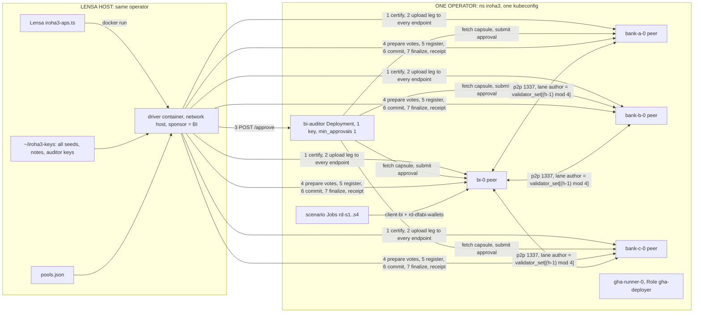
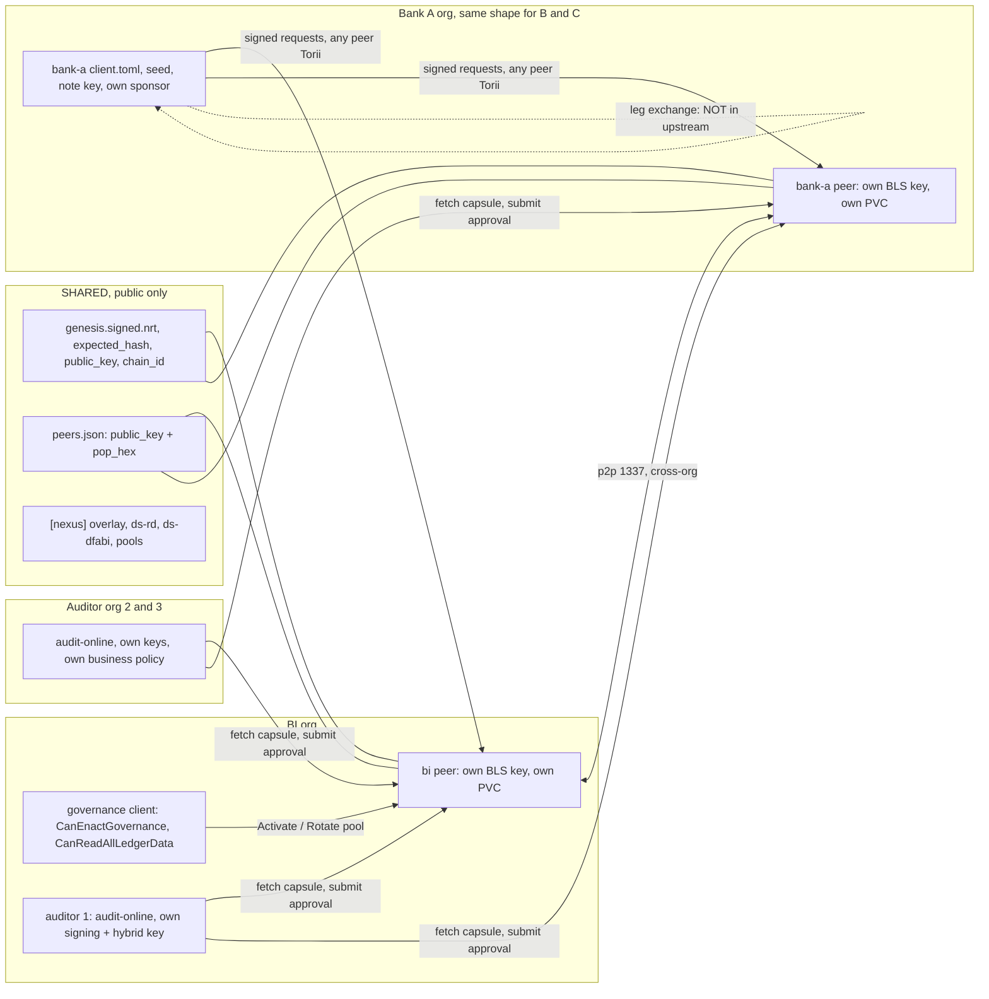
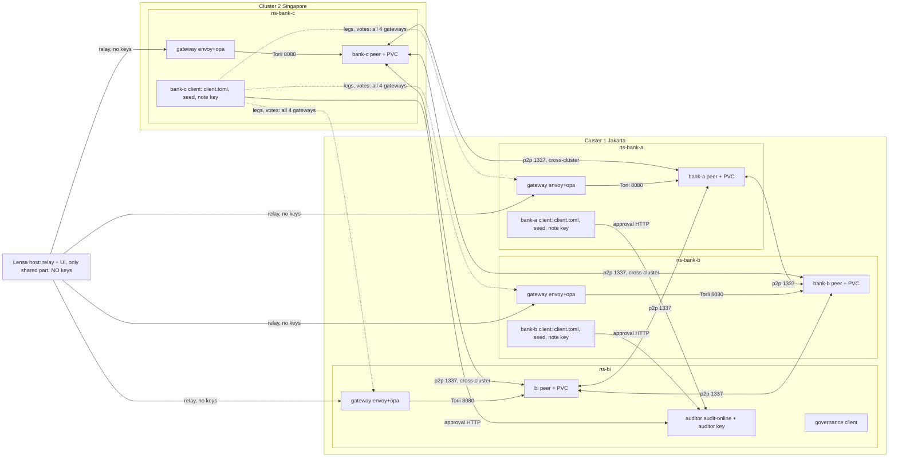

# ARCHITECTURE-iroha3

Date 2026-11-11. Upstream pin `hyperledger-iroha/iroha@071e281e778c5928cab4d6e007b7ddc9b050df27` (checked: `git log -1` in upstream/iroha-071). Project `iroha3@e2a1794` (read with `git show e2a1794:`; HEAD 589d9e0 only adds NOTES.md), driver `iroha3-rd-node-build@be4dd89`, frontend `@ed7b78b`. Live reads from ns `iroha3`, read-only, secret names only. `docs.iroha.tech` is a JS app and was not used; all citations are repo files at the pin.
Scope: Iroha 3 APS track. Objectives: (a) validator per bank, (b) self-submit per bank, (c) third-party auditor. R1 ALIGNED protocol / GAP Lensa; R2 ACCEPTED; R3 ALIGNED. No custom code beyond what exists.

## 1. BEFORE (today): one operator runs everything

| Box / arrow | Source |
|---|---|
| 4 peers, 1 replica each, own PVC 5Gi, Secret `peer-<party>`, `--sora --config /config/peer.toml` | `deploy/k8s/base/statefulset.yaml:56,120,130-133`; live `kubectl get sts,pvc -n iroha3` (4 STS, 4 PVC, 4 nodes) |
| All 4 peers keys made by one operator PC run; genesis private key in `network/out` | `network/generate.sh:2-4,65-68,429-430` |
| `peers.json` = party, public_key, pop_hex only | `network/public/peers.json`; `generate.sh:155-159` |
| 3 lanes (universal, ds-rd, ds-dfabi), all 4 validators in all, stake_elected, `max_validators = 4`, fault_tolerance 1 | `network/nexus.toml:8-9,14-30,63-69` |
| Each party holds 1000 XOR at genesis; fee 0.001 per instruction | `network/genesis-rd-dfabi.jq:26`; `nexus.toml:78-83` |
| Committee-role consensus key per peer, built from peer key + PoP | `generate.sh:312-316,365-397` |
| Sponsor is always BI (client-bi `client.toml`) | `driver/src/aps.rs:207`; `pools.rs:273,346`; `config.rs:96-102` |
| Driver holds payer, recipient and sponsor keys in one process; recipient note secrets derived from recipient `.note` | `aps.rs:1175,1211,1283-1289`; `pools.rs:388-394`; `config.rs:126-132` |
| Lensa runs driver with host network, mounts `~/iroha3-keys` and pools dir | `frontend@ed7b78b server/src/adapters/iroha3-aps.ts:9-10,14,34-37` |
| certify, upload to every endpoint (fails on first error), prepare, commit, finalize, wait receipt | `aps.rs:352-380,418-450` |
| Auditor: custom HTTP service, one key, `min_approvals: 1`, one `auditors` entry; Secret `bi-auditor-key`, PVC `bi-audit-store`, own NetworkPolicy | `driver/src/auditor.rs:1-6`; `aps.rs:246-248,384-393,879-884`; `deploy/k8s-apps/bi-auditor.yaml:8-10,21-28,89,110`; `NOTES.md:45` |
| Pool activation by the same BI client | `aps.rs:279-291` (permission: see section 2, Governance) |
| `pools.json`: public data only (origin commitments, bundle ids), single writer | `pools.rs:4-8,105-111`; `NOTES.md:22` (M1 race) |
| Torii: headless ClusterIP `:8080`, any pod in ns may call; no ingress | `deploy/k8s/networkpolicy.yaml:18-22`; live `kubectl get svc,ingress -n iroha3` |
| One runner with Role `gha-deployer` (pods/exec, secrets get/list) | `agents/analyst/reports/2026-11-11-platform-iroha3.md` (live read, not repeated) |
| Lane author fixed per height, no failover; BI down = no user tx | `iroha@071e281e crates/iroha_core/src/lane_consensus.rs:96-107,854-860`; `iroha3/reports/g1-network.md` |
| Live: 4 peer pods, bi-auditor, gha-runner-0, Jobs rd-s1..s4 + selftest; Secrets `peer-*`, `client-*`, `rd-dfabi-wallets`, `bi-auditor-key` | `kubectl get pods,secret,jobs -n iroha3` 2026-11-11 |

## 2. AFTER (target): one org per box, shared public artifacts only

| Box / arrow / setting | Upstream citation (iroha@071e281e) |
|---|---|
| Per-validator key + PoP: `kagami keys --algorithm bls_normal --pop --out-dir` writes `public.key`, `private.key`, `pop.hex`; private key never printed | `crates/iroha_kagami/README.md:77-87,223-235`; `crates/iroha_kagami/src/crypto.rs:18-28` |
| Genesis from public data only: `kagami genesis ... --peer-pop PK=POP` per peer, `--private-key-file` of the genesis signer, `--expected-hash-out`; hash file = trust root for `genesis.expected_hash_file` and client `network_id_file` | `crates/iroha_kagami/README.md:249-273` |
| Peer config carries `trusted_peers` + `trusted_peers_pop`, BLS only | `crates/iroha_config/src/parameters/user.rs:845,857,1096` |
| Our genesis step already reads only `peers.json` for the Committee keys (so keys may be made elsewhere) | `generate.sh:330-397`; spec `specs/private_settlement.md:46-50` |
| Authority = exact 4-peer roster from consensus, `f = 1`, every BLS PoP verified, live Committee key per member | spec `:42-52` |
| Committee-only peer exists upstream (registered, in P2P, not in lane-0 topology). Liveness effect NOT verified; not used | spec `:49-50` |
| Peer startup, probes, PVC | `deploy/k8s/base/statefulset.yaml:56,73-91,133` |
| Bank client: own `client.toml` (chain, torii_url, network_id_file, account domain/private_key/public_key); same shape as driver `client_with_key` | `driver/src/config.rs:105-123`; `crates/iroha_kagami/src/client_configs.rs` exists (not read) |
| Torii auth: leg upload, availability, votes = any canonical account signature; bundle carriers = sponsor signature; capsule/approvals = identity-bound governed auditor; receipts public | spec `:545-559` |
| Every client must reach all four Torii endpoints (exactly four distinct, canonical order, 3-of-4 quorum) | spec `:296-310`; `crates/iroha/src/client/private_settlement.rs:379-470` |
| Own sponsor: carrier authority must equal `manifest.sponsor` and fee intent; sponsor also gets leg-0 reimbursement output | `crates/iroha_core/src/private_settlement/carrier.rs:215-219`; spec `:457-499` |
| Pool governance stays at BI: `ActivatePrivateSettlementPoolV1` and `RotatePrivateSettlementPoolPolicyV1` both call `ensure_privacy_governance` (CanEnactGovernance; genesis grants it to one account) | `crates/iroha_core/src/smartcontracts/isi/private_settlement.rs:23-29,49-55`; `smartcontracts/isi/privacy.rs:110,6086`; `generate.sh:392`; `crates/iroha_data_model/src/isi/private_settlement.rs:106,139` |
| Auditors: `min_approvals`, `auditors` (id, signing_key, hybrid encryption_key), `1 <= k <= n <= 32` | `crates/iroha_data_model/src/nexus/private_settlement.rs:61,2077-2084,2127-2129,2222-2227` |
| Capsule DEK wrapped independently per auditor in policy order, so each auditor decrypts alone | `crates/iroha_core/src/private_settlement/audit.rs:4-5,163-173` |
| Prepare vote refuses if approvals < `min_approvals` | `private_settlement/state.rs:1118`; `data_model/.../private_settlement.rs:3958-3964` |
| Third-party auditor as separate org process: `iroha nexus private-settlement audit-online` (4 `--committee-endpoint`, `--committee-authority`, `--payload-digest`, `--pool-governance`, `--auditor-decryption-key-file`, `--business-policy`, `--decision`); signing key must not be a committee consensus key; business policy allowlists payer/recipient/sponsor/asset | `crates/iroha_cli/README.md:194-256`; `crates/iroha_cli/src/nexus.rs:229-257`; spec `:296-340` |
| Rotation: exact current `governance_digest`, revision +1, strictly newer `key_epoch`, no pending bundle across the boundary; retired decryption keys kept (`--auditor-retired-decryption-key-file`) | spec `:375-392,353-360`; `nexus.rs:249` |
| Reads of all ledger data need `CanReadAllLedgerData`; it is genesis-only and not delegable after genesis | `iroha_torii/src/lib.rs:19382-19390`; `iroha_executor_data_model/src/permission.rs:486-491`; `iroha_core/src/executor.rs:8225-8236`; `executor_initial_permission_authority.rs:668-676` |
| Holder of `CanReadAllLedgerData`: BI only (as auditor-side reader). Today a shared operator account, same on all nodes; BI's own key cannot read A to B tx | `iroha3/reports/a-dataspace-restricted.md:61,215`; not in `genesis-rd-dfabi.jq` (grants there: CanReadRestrictedDataspace only, `:16-17,27-28`); source of the grant not re-verified |
| Shared artifacts stay: dataspaces ds-rd (id 1), ds-dfabi (id 2), 2 pools, APS overlay. Genesis is signed against a `peer.toml`, so `[nexus]` is a shared, byte-agreed section | `nexus.toml:14-53,98-105`; `generate.sh:403-415` |

### Multi-party leg question (two-leg DvP, can each bank prove its own leg?)

Finding: protocol routes allow it, library and docs give no way to do it. Status: NOT SUPPORTED as shipped; a transport would be new custom code.
- Routes: leg upload and availability certify accept any account signature (spec `:547-548`); only bundle carriers need the sponsor (spec `:557`, `carrier.rs:215`). So legs may be uploaded by different authorities at route level.
- Library: `certify_and_upload_private_settlement_legs_v1` takes all legs in one call and rejects a material whose manifest differs from the first (`crates/iroha/src/client/private_settlement.rs:2527-2557`). `finalize_atomic_private_settlement_provisional_bundle_v1` takes one input per manifest leg (`crates/iroha_core/src/privacy_engines/atomic_private_settlement/wallet.rs:379-384`). The prepared leg (statement, proof, delta, capsule; no witness) derives only Clone/PartialEq/Eq, "native client-side construction value rather than wire object" (`wallet.rs:139-148,222-228`). Witness stays in an owner-only wallet file inside Rust (`wallet.rs:1-8`; spec `:197-209`).
- Manifest is a public-intent skeleton fixed before proving (`wallet.rs:365-372`), so each payer could prove locally if it had the skeleton.
- Cross-party inputs each leg needs: recipient signs a view-key authorization body that binds its one-time view key and note spending authority (`data_model/.../private_settlement.rs:965-994,1645-1665`); sponsor signs the leg-0 reimbursement authorization. Driver does all of this in one process (`aps.rs:1283-1289`).
- Docs: grep of `specs/private_settlement.md` for witness, multi-party, exchange, interactive, assemble: no protocol for passing legs or authorizations between clients. Spec step 1 says "client creates proof and encrypted capsule locally" (`:444-447`). Result: "not found".
- Even `pay` is two-party today: companion leg BI to BI (`NOTES.md:44`; `pools.rs:301`). Self-submit by a bank therefore still needs a BI leg.

### Hard limits (cannot be fixed on our side)

1. Fixed lane author: `validator_set[(lane_height-1) % n]`, no view input; autonomous artifact rejected if producer differs (`lane_consensus.rs:96-107,854-860`). Any single peer down stops user txs. Spreading peers over orgs makes a stall more likely, not less. R2 ACCEPTED.
2. V1 geometry: exactly 4 validators per authority, `f = 1` (spec `:44-46`); `max_validators = 4` (`nexus.toml:69`). A fifth bank peer is impossible; banks A, B, C and BI is the full set.
3. Online auditor required: `min_approvals >= 1` (`data_model/.../private_settlement.rs:2224-2227`; `state.rs:1118`). ACCEPTED. Cost: auditor down = no Prepare.
4. No multi-party witness exchange (section above). Per-bank proving of both legs stays blocked by the no-custom rule.
5. APS "not production-qualified" (spec `:27-29`); STARK note tree in `driver/src/tree.rs` is custom (crate-private `proof_managed_accumulator.rs`), kept.
6. `CanReadAllLedgerData`, `CanReadRestrictedDataspace` are genesis-only (`executor.rs:8225-8236`); changing holders means a new genesis.

## 2a. Deployment topology (user decision 2026-11-11)

Rule: one namespace = one full Iroha stack per org (peer, bank client/driver with its own `client.toml` + seed + note key, gateway envoy+opa, PVC); only Lensa is shared. ns-bi also holds the auditor and pool governance. Cluster 1 (Jakarta) = ns-bi, ns-bank-a, ns-bank-b. Cluster 2 (Singapore) = ns-bank-c. Where section 2 says "org box", read "namespace".

Namespace must contain (per org). Upstream pin `071e281e`; samples `defaults/nexus/config.toml`, `specs/references/peer.template.toml`.

| Item | What goes in the namespace | Citation |
|---|---|---|
| Peer `[network]` | `address` = bind `0.0.0.0:1337`; `public_address` = the external address other peers dial (gossiped to others); `[torii] address` `0.0.0.0:8080`. Our generator rewrites these keys only; no `sumeragi` section, so consensus timing is the default | `iroha_config/src/parameters/user.rs:7836-7843`; `defaults/nexus/config.toml:22-27`; `generate.sh:119-134` |
| `trusted_peers` | `"<bls public key>@<host>:1337"` for all four peers; `trusted_peers_pop` entries define the validator subset (a trusted peer without PoP is an observer). The bank-C address must be reachable from cluster 1 (LB or NodePort: our choice; upstream has no Kubernetes cross-cluster recipe, grep of `docs/`, `configs/`: not found). A DNS name here can follow IP changes if `dns_refresh_interval_ms` is set (off by default) | `user.rs:844-857,8037-8039`; `defaults/nexus/config.toml:9-16`; `generate.sh:105-106` |
| Genesis topology | Genesis lists `PeerId` = public key only, plus `pop_hex`, no address (`iroha_model_base/src/peer.rs:44-48`; `iroha_genesis/src/lib.rs:3068-3076`). So moving bank C to cluster 2 with the same key needs NO genesis change, only config. Lead's claim "genesis `topology []` avoids a reset": NOT supported. Our `topology: []` is only on the extra transactions (`genesis-rd-dfabi.jq:29,36`; `generate.sh:303,397`); the first transaction comes from `kagami localnet` with the 4 peers (`generate.sh:70-71`); signing requires an exact `3f+1` topology (4..=`MAX_VALIDATORS_PER_HEIGHT`) over all transactions, matching the epoch-zero authority. A roster change needs a new genesis | `iroha_genesis/src/lib.rs:3002-3011,3830-3860` |
| BLS PoP per peer | Each org makes its own key + PoP; all four `public_key`+`pop_hex` pairs go to every peer and to the genesis signer | spec `:44-46`; `kagami README.md:77-87`; `generate.sh:155-159` |
| NetworkPolicy | Today: 1337 from same-label pods, 8080 from any pod in the ns (`networkpolicy.yaml:11-22`). Target: peer 1337 from the other three peers (`namespaceSelector` in cluster 1, `ipBlock` for cluster 2 and for cluster-1 egress seen by C); peer 8080 only from the own gateway pod; gateway listener from client and Lensa CIDRs (`ipBlock`). Caveat: LB/NAT may rewrite the source IP and the docs do not define whether before or after policy; test | kubernetes.io/docs/concepts/services-networking/network-policies ("ipBlock", "Cluster ingress and egress mechanisms") |
| Bank client | `client.toml`: `chain`, `network_id`, `torii_url` (own gateway), `[account] domain/public_key/private_key`; remove the sample `[basic_auth]` table. A client must reach all four Torii endpoints (exactly four, canonical order) | `defaults/client.toml:1-3,9-12`; `generate.sh:147-154`; spec `:296-310`; `driver/src/config.rs:105-123` |
| Auditor | Only in ns-bi: `iroha nexus private-settlement audit-online` (or today's custom `bi-auditor`); clients POST approval requests from their own ns | `crates/iroha_cli/README.md:194-256`; spec `:296-340`; `aps.rs:384-393` |
| Key custody | One Secret per ns: `peer-<party>`, `client-<party>` (seed, note key); auditor key only in ns-bi; genesis private key destroyed (DELTA 2) | `deploy/secrets.sh:48-52`; `statefulset.yaml:120-133` |

Rolling restart after a `trusted_peers` change: not documented upstream (grep of `docs/source`: not found). Config is read at start (`crates/irohad/src/main.rs:8657,9101`), `kiso.rs` has no runtime update of it, and only the gossiper updates the live trusted set (`peers_gossiper.rs:1005`). Inferred: edit and restart BI, A, B one by one. Each restart is one peer down = user txs halt while it is the lane author (limit 1). Gossip of a moved peer's address (`peers_gossiper.rs:1-4`) may let the others learn it without edits: not tested.

Relay: upstream has `relay_mode` (`disabled` default = "full mesh expected", `hub`, `spoke`, `assist`) for NAT-constrained peers; spoke/assist need `relay_hub_addresses` (`user.rs:445-458,7844-7855,8338-8342`). Not needed for two reachable clusters; not tested, not used.

### Capacity on cluster 2

Bank C goes only into NEW namespaces this project creates (naming: lead). The capacity left over is shared with unrelated workloads and is not ours to change. The first write to cluster 2 is a CLUSTER-OP that creates new namespaces only. Peer requests 250m / 1Gi, limits 2000m / 3Gi, PVC 5Gi (`statefulset.yaml:66-71,133`); client + gateway are small. Bank-C Iroha share ≈ 3 to 4 pods, ≈ 0.4 vCPU / 1.4 GiB requests (CLUSTER2-FACTS). Node level: ≈ 9 vCPU / 29 GiB unrequested of ≈ 23.4 vCPU / 53 GiB allocatable, so it fits on paper. Memory is the binding limit (member nodes 76% to 98% used) and the 3 GiB limit overcommits: place the peer on a member node. The base PVC class `alicloud-essd-wffc` (`statefulset.yaml:130`) is not in cluster 2's class list (`alicloud-essd`, `fabricx-essd`): overlay it. Sequence: second, after Besu + Paladin + gateways.

### Cross-region latency

RTT Jakarta to Singapore ≈ 15 ms (measured, API-server path); assume ≤ 30 ms. `block_time_ms` and `commit_time_ms` are not config in this pin (only telemetry metrics, `specs/telemetry.md:509`). Cadence is `block_cadence_ms`, default 1000 ms, signed in genesis and frozen at start (`defaults.rs:4009`; `iroha_data_model/src/parameter/system.rs:356-361`); our `network/` files do not set it (`git grep` at `e2a1794`: only `*_timeout_blocks`, `nexus.toml:103-105`). View-zero round timeout = 10 x cadence = 10 s; retransmit = timeout / 5 = 2 s (`defaults.rs:4011,4013`; `iroha_config/src/parameters/actual.rs:6971-6987`). Margin: 30 ms is 3% of cadence, 0.3% of the round timeout, 1.5% of retransmit; even four sequential round trips (120 ms, my estimate) stay at 12% of one cadence. Result: no change.

### Cross-cluster limits

1. Fixed lane author (`lane_consensus.rs:96-107,854-860`): a cluster 2 outage or a WAN cut stops all user txs; no failover. Two clusters add a failure mode, not tolerance.
2. Four-validator geometry (spec `:44-46`; `nexus.toml:69`): bank C stays the fourth validator; no fifth peer, so cluster 2 cannot be an extra replica.
3. Auditor online (`min_approvals >= 1`, `state.rs:1118`): ns-bi auditor must be reachable from cluster 2 clients over the WAN.
4. Discovery: static `trusted_peers` plus address gossip (`peers_gossiper.rs:1-4`); no DNS-SD or seed-node scheme found.
5. Per-org leg exchange is still not in upstream (section 2); the topology does not change it.

### Resolved 2026-11-11 (after lead's team review): address-only move needs no re-signed genesis
`GenesisTopologyEntry { peer: PeerId, pop_hex: Option<String> }` (iroha@071e281e crates/iroha_genesis/src/lib.rs:3070-3076) and `PeerId { public_key }` only (crates/iroha_model_base/src/peer.rs:44-47). The socket address lives in `Peer { address, id }` (crates/iroha_data_model/src/peer.rs:34-39), which is runtime config (`trusted_peers`), not genesis. Moving bank C's peer to cluster 2 with the same key is a config change on every peer plus restart; the 3f+1 signing rule (lib.rs:3829-3860) applies only when the key set changes. TEAM RESPONSE: besu withdrew "shared CA" (DirectCertVerification default true, config.go:45, grpc_transport.go:126; cross-cluster cert needs subject CN = registered node name); iroha withdrew "no genesis reset" for key-set changes; block_cadence_ms accepted.

## 3. DELTA (numbered)

| # | What | Source | Objective | Files / objects | Cost |
|---|---|---|---|---|---|
| 1 | Per-bank key custody. 1a: move `bi-auditor.seed/.hybrid` out of `~/iroha3-keys` into the auditor org only. 1b: each bank keeps only `<party>.seed` + `<party>.note`; Lensa host stops mounting all seeds. 1b is only complete after item 7 (today one process needs payer, recipient, sponsor keys) | `aps.rs:1175-1211,1283-1289`; `pools.rs:388-394`; `iroha3-aps.ts:14`; spec `:324-340` | (b), (c) | `~/iroha3-keys`, Secrets `rd-dfabi-wallets`, `client-bi`, `bi-auditor-key`, `deploy/jobs/scenario.yaml`, `deploy/secrets.sh:48-52` | M |
| 2 | Per-bank peer key and genesis ceremony: each org runs `kagami keys --algorithm bls_normal --pop`, publishes `public_key` + `pop_hex`; one signer builds genesis from `peers.json` only; destroy genesis private key; each org verifies `kagami genesis validate` + `expected_hash`. Split `generate.sh` into per-party keygen and assembly (assembly already reads peers.json only). Needs re-genesis (new chain id) | `kagami README.md:77-87,223-273`; `generate.sh:65-68,330-397,403-430` | (a) | `network/generate.sh`, `network/public/*`, Secrets `peer-*` | M |
| 3 | Per-bank own namespace (cluster 1: BI, A, B; cluster 2: C, see 2a): own STS, PVC, Secret `peer-<party>`, own deployer; remove cross-party `secrets get/list` runner role. Cross-org P2P :1337 and Torii :8080 reachability and `trusted_peers` addresses (currently in-ns DNS); NetworkPolicy now allows only same-ns | `statefulset.yaml:56,120-133`; `networkpolicy.yaml:11-22`; `generate.sh:91-110` | (a) | `deploy/k8s/parties/*`, `deploy/runner/rbac.yaml`, overlay per org | L |
| 4 | Own client + sponsor per bank: `client.toml` from the bank's own account key (each already holds 1000 XOR); driver reads `sponsor(<party>)` instead of `"bi"`; BI sponsorship becomes an option. Limited by item 7 for DvP and by companion BI leg for `pay` | `aps.rs:207`; `pools.rs:273,346`; `config.rs:96-102`; `carrier.rs:215`; `genesis-rd-dfabi.jq:26` | (b) | `driver/src/{aps,pools,config}.rs` (existing code, parameterize), Secrets `client-<party>` | M |
| 5 | Second auditor org, k-of-n. Default proposed: 2-of-3 (BI, org 2, org 3) so one auditor down does not stop settlement; 2-of-2 is the minimum. Policy `min_approvals` and `auditors` from config, not hardcoded 1 and one entry. Org 2 runs official `audit-online` with own keys and business policy (allowlist includes all 4 sponsors). Driver waits for approvals instead of calling one `/approve` | `aps.rs:879-884,384-393`; `data_model .../private_settlement.rs:2127-2129,2222-2227`; `audit.rs:163-173`; `crates/iroha_cli/README.md:194-256` | (c) | `driver/src/aps.rs` (`govern_until`, approve loop), new org deployment, policy files | M |
| 6 | Rotate existing pools to the new policy: `RotatePrivateSettlementPoolPolicyV1`, new `key_epoch`, revision +1, no pending bundle across the boundary; keep BI retired hybrid key (`--auditor-retired-decryption-key-file`) for old capsules. Alternative: new pools at re-genesis (item 2) with the k-of-n policy from the start | spec `:353-360,375-392`; `isi/private_settlement.rs:49-55`; `nexus.rs:249` | (c) | `pools.json`, BI governance client, `bi-audit-store` PVC | M |
| 7 | Leg exchange for per-bank proving (skeleton manifest out, recipient view-key authorization + sponsor authorization in, four prepared-leg fields to the assembler). Not in upstream; needs custom transport. BLOCKED by the no-custom rule; user decision needed. Without it, item 1b and item 4 stay partial | section 2 multi-party; `wallet.rs:139-148,222-228,365-384`; `client/private_settlement.rs:2527-2557` | (b) | new code in driver; not started | L |
| 8 | Split governance/reader account from sponsors: CanEnactGovernance + CanReadAllLedgerData only at BI, not in `client-bi` shared with Jobs and Lensa. Genesis-only, so part of item 2 | `generate.sh:392`; `executor.rs:8225-8236`; `reports/a-dataspace-restricted.md:61,215`; `privacy.rs:110` | (b), R1 | genesis, `client-bi`, `deploy/jobs/*` | M |
| 9 | Pools index: `pools.json` published by BI (public data), single writer; each bank scans its own notes from receipts | `pools.rs:4-8,105-111,351`; `NOTES.md:22` | (b) | `pools.json`, Lensa `iroha3.ts` | S |
| 10 | Lensa moves to per-bank clients and Torii endpoints (no port-forwards to all peers, no host with all keys) | `iroha3-aps.ts:9-10,34-37` | (b) | frontend adapter, `lensa.service` | M |
| 10a | DELTA addendum (DEVIATION REQUEST iroha3 PLAN.md S16, 2026-11-11). A per-bank driver **server mode** (thin HTTP wrapper over the existing `pay`, `dvp-shared`, `wallet` commands) running in the bank namespace is inside the AFTER: it is project client code in `iroha3-rd-node-build`, the same class as the existing `auditor` HTTP mode (`driver/src/auditor.rs:1-6`), not chain, Paladin or upstream code; "no custom code" (line 4, TEAM.md §11, user rule 2026-11-10) binds official components only. Conditions: runs only in that bank's namespace; mounts only `<party>.seed` + `<party>.note` (item 1b), never the auditor key (item 1a); exposes only the existing commands, no new chain logic; reachable only through that bank's gateway envoy+opa with mTLS (2a NetworkPolicy row); Lensa calls it as a relay and holds no key and no kubeconfig (2a "Lensa host: relay + UI, NO keys"). Limit unchanged: a two-leg DvP still needs the BI sponsor path until the user decides item 7. No-code alternative checked: Lensa driving the driver by `docker run` (`iroha3-aps.ts:37-41`) or `kubectl exec` needs host or cluster-admin access to the keys, which the AFTER removes; none citable. TEAM RESPONSE (lead): same reading, "project client code, no target change". Verdict: ACCEPTED as addendum, no deviation. | `auditor.rs:1-6`; `iroha3-aps.ts:37-41`; items 1b, 7, 10; 2a | (b) | `iroha3-rd-node-build` driver, bank namespace Deployment, gateway policy | M |
| 11 | Drift: re-run S1 and S2b on `be4dd898`; probe upload with one peer down (`aps.rs:374-379` fails on first error) | `aps.rs:374-379`; `agents/analyst/reports/2026-11-11-iroha3-driver-fabricx-bi-down.md` | (a) | scenario Jobs | S |

| 12 | Cluster 2 for bank C: peer `public_address` (LB or NodePort), `trusted_peers` update on all peers (rolling restart BI, A, B), NetworkPolicy `ipBlock`s for 1337 and 8080, bank-C gateway, PVC class overlay. No genesis change (key stays) | 2a; `user.rs:844-857,7840-7843`; `peer.rs:44-48`; `statefulset.yaml:130`; `networkpolicy.yaml:11-22` | (a) | `deploy/k8s/parties/bank-c`, overlay for cluster 2, `generate.sh:105-124` (addresses) | M |
| 1c | DELTA addendum (PR #38 S4, 2026-11-11). Rotate the BI `[streaming] identity_private_key` that was printed to a terminal on 2026-11-11 (CURRENT.md §11): new key in Secret `peer-bi` only, restart `bi-0`; preserves AFTER 2a row "BI org: own BLS key, own PVC". User-only (key material), CLUSTER-OP. Source: config read at startup (`irohad/src/main.rs:8657,9101`), so a restart applies it; no upstream rotation ISI for the streaming identity found ("not found"). | `irohad/src/main.rs:8657,9101`; `iroha_config/src/parameters/user.rs` streaming section | (b) | Secret `peer-bi`, sts `bi-0` | S |
| 12a | DELTA addendum (PR #38 S19, user directive 2026-11-11). Decommission the old single-namespace `iroha3` stack on cluster 1 after the new per-bank namespaces pass VERIFY.md end to end: scale STS to 0, keep PVs with `persistentVolumeReclaimPolicy: Retain`, named backup of `pools.json` and peer PVCs, then delete the namespace. Destructive: user-only, CLUSTER-OP, cluster 1 only, last step. Preserves AFTER 2a (one namespace per bank). | kubernetes.io/docs/concepts/storage/persistent-volumes/#reclaiming (Retain); `TEAM.md` §5 user-only list | (a),(b) | ns `iroha3`, PVCs, `pools.json` | M |
| 13 | DELTA addendum (PR #38 S14, 2026-11-11). Gateway envoy+opa per namespace in front of Torii 8080: one `bank-gw` Deployment per bank namespace with mTLS client auth, OPA bundle per org, NetworkPolicy `peers-torii` allowing 8080 only from that namespace's gateway pods; Lensa reaches Torii only through it. Already an AFTER 2a row ("gateway envoy+opa per namespace", "NetworkPolicy ... 8080 from that namespace's gateway"); this line gives it a DELTA number. Ordering: must precede any step that reads Torii from outside the peer pod (S8 status reads, S11 auditor fetch, S13 pool-init). | ARCHITECTURE-iroha3.md 2a rows gateway + NetworkPolicy; `besu/opa` gateway pattern (envoy v1.38.9, opa 1.21.1); kubernetes.io NetworkPolicy podSelector | (b) | per-namespace Deployment `bank-gw`, netpol `peers-torii` | M |

Sequence under no-custom: 2 and 8 first (one re-genesis), then 3, 5, 6 (or fresh pools), then 4 and 9 and 10. Item 12 follows item 3 (bank C last, after Besu and Paladin on cluster 2). Item 7 is the gate for full (b).

## 4. SOURCES (pin, 2026-11-11)

- `hyperledger-iroha/iroha@071e281e778c5928cab4d6e007b7ddc9b050df27`: `specs/private_settlement.md`; `crates/iroha_core/src/{lane_consensus.rs,executor.rs,executor_initial_permission_authority.rs}`; `crates/iroha_core/src/private_settlement/{carrier,audit,state}.rs`; `crates/iroha_core/src/privacy_engines/atomic_private_settlement/wallet.rs`; `crates/iroha_core/src/smartcontracts/isi/{private_settlement,privacy}.rs`; `crates/iroha_data_model/src/nexus/private_settlement.rs`; `crates/iroha_data_model/src/isi/private_settlement.rs`; `crates/iroha/src/client/private_settlement.rs`; `crates/iroha_cli/{README.md,src/nexus.rs}`; `crates/iroha_kagami/{README.md,src/crypto.rs}`; `crates/iroha_config/src/parameters/user.rs`; `crates/iroha_torii/src/lib.rs`; `crates/iroha_executor_data_model/src/permission.rs`
- `radityaaa43/iroha3-rd-dfabi@e2a1794`: `network/{nexus.toml,genesis-rd-dfabi.jq,generate.sh,public/peers.json}`, `deploy/k8s/base/statefulset.yaml`, `deploy/k8s/networkpolicy.yaml`, `deploy/k8s-apps/{bi-auditor.yaml,rd-dfabi.toml}`, `deploy/secrets.sh`, `NOTES.md`, `reports/{g1-network,a-dataspace-restricted}.md`
- `radityaaa43/iroha3-rd-node-build@be4dd89`: `driver/src/{aps,pools,config,auditor}.rs`
- `rd-lensa-frontend@ed7b78b`: `server/src/adapters/iroha3-aps.ts`
- Prior reports: `agents/analyst/reports/2026-11-11-{platform-iroha3,iroha3-driver-fabricx-bi-down,matrix}.md`
- Live, read-only, `KUBECONFIG=alibaba.yaml`, ns `iroha3`: `get pods,svc,pvc,secret,cm,networkpolicy,jobs,deploy,sts,ingress` (names only)
- Not verified: `docs.iroha.tech` (JS app); `crates/iroha_kagami/src/client_configs.rs` contents; source of `CanReadAllLedgerData` grant in our genesis; behavior of a Committee-only peer for lane liveness; cross-org P2P transport security; whether client-bi holds CanEnactGovernance (inferred from `aps.rs:279-291`, secret values not read)
- Added 2026-11-11 (section 2a), `hyperledger-iroha/iroha@071e281e`: `crates/iroha_config/src/parameters/{user,actual,defaults}.rs`, `crates/iroha_genesis/src/lib.rs`, `crates/iroha_model_base/src/peer.rs`, `crates/iroha_data_model/src/parameter/system.rs`, `crates/iroha_core/src/{kiso,peers_gossiper}.rs`, `crates/irohad/src/main.rs`, `defaults/{client.toml,nexus/config.toml}`, `specs/{references/peer.template.toml,telemetry.md}`; `radityaaa43/iroha3-rd-dfabi@e2a1794`: `network/generate.sh`, `network/genesis-rd-dfabi.jq`, `deploy/k8s/{base/statefulset.yaml,networkpolicy.yaml}`; `kubernetes.io/docs/concepts/services-networking/network-policies` (fetched 2026-11-11); `design/CLUSTER2-FACTS.md` (node-level only, RTT 15 ms)
- Not verified (2a): rolling restart after `trusted_peers` change (not documented; inferred from startup config read); address gossip making restarts of other peers unnecessary; LB/NAT source IP vs `ipBlock` on Alibaba; lead's claim that an empty genesis topology avoids a reset (contradicted, see 2a)
