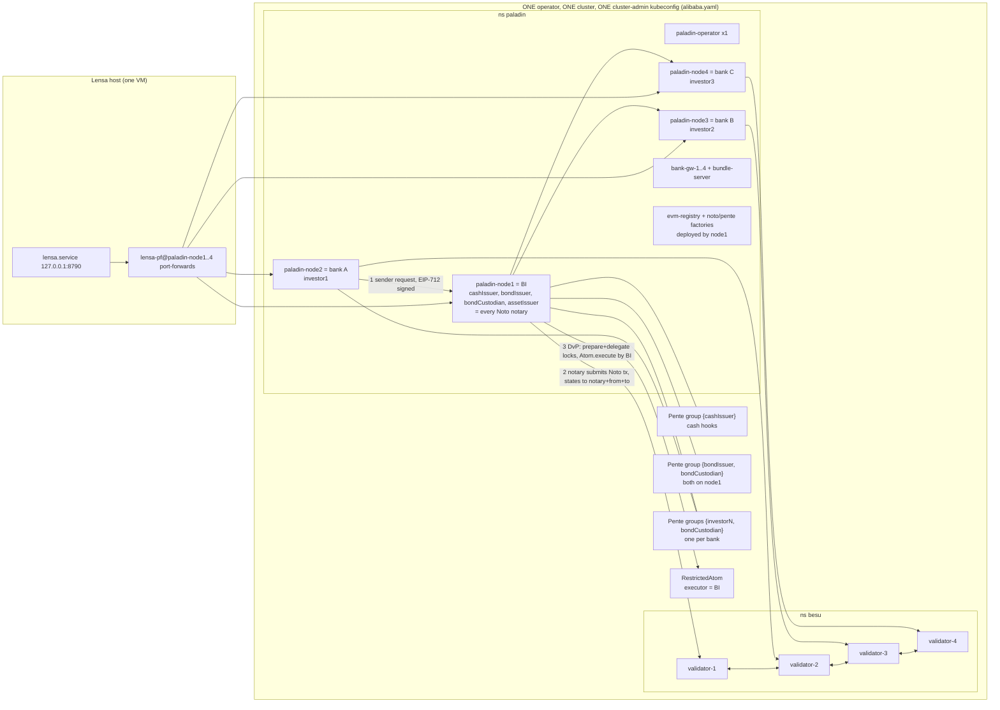
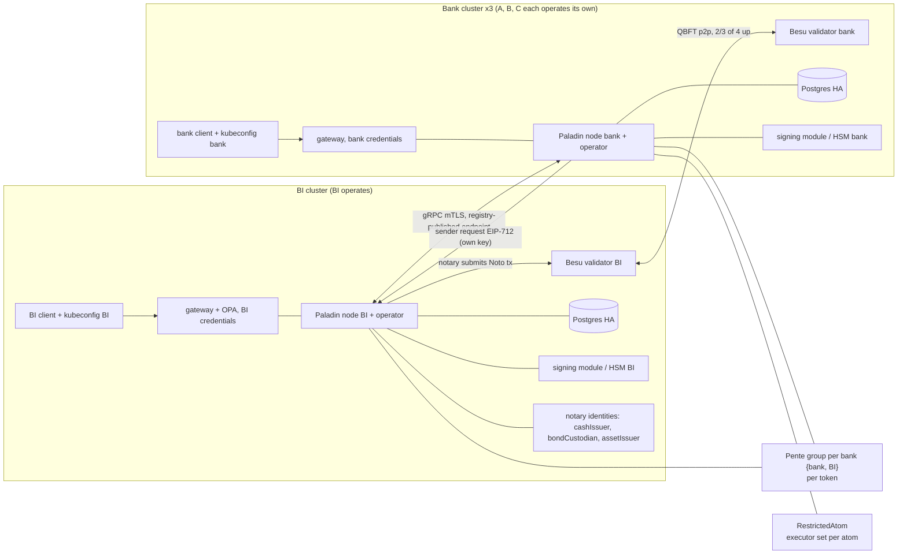

# ARCHITECTURE-noto-pente

Track Noto + Pente. Date 2026-11-11. Read-only research. Project: besu@927f572, frontend@aa6e09b. Upstream: paladin@v1.0.0 (6d4b913, `git describe --tags` = v1.0.0). Besu docs: context7 `/websites/besu-eth` (docs.besu-eth.org, site docs, not version-pinned; running image is hyperledger/besu:26.8.1).
Shared rows (validators, nodes, operator, Postgres, keys, ingress, kubeconfig, Lensa host) re-checked live and in `agents/analyst/reports/2026-11-11-platform-zeto.md`.
Citation form: `paladin:<path>:<line>` = paladin@v1.0.0. "not opened" = I did not open it. "not found" = grep found nothing.

## 1. BEFORE (today)

| Box / arrow | Source |
|---|---|
| validators 1-4, one namespace, 20d, image hyperledger/besu:26.8.1 | live `kubectl get sts -n besu` (besu-node-validator-1..4) |
| owner per validator (1=BI 2=A 3=B 4=C) | inferred from netpol pairs (`kubectl get netpol -n besu`); not recorded, UNVERIFIED |
| paladin-node1..4, 53d, CR phase Ready | live `kubectl get sts,paladin -n paladin` (sts paladin-node1..4, paladin node1..4) |
| node1 reads validator-1; sidecar Postgres 20Gi; HD wallet secret node1.keys; grpc 9000 selfsigned-issuer | live `kubectl get paladin node1 -n paladin -o json` spec (baseLedgerEndpoint, database.mode sidecarPostgres, secretBackedSigners autoHDWallet, transports grpc) |
| operator x1 manages all 4 CRs | live `kubectl get deploy -n paladin` (paladin-operator 1/1) |
| bank-gw-1..4, bundle-server | live `kubectl get deploy -n paladin`; secrets bank-gw-N-mtls (names only) |
| ingress paladin-node1..4, one shared basic-auth secret paladin-basic-auth | live `kubectl get ingress -n paladin`; secret name only |
| registry, noto/pente/zeto factories | live `kubectl get paladinregistry,paladindomain,smartcontractdeployment -n paladin`; deployer = node1 per platform-zeto.md (registry owner not read) |
| identities cashIssuer/bondIssuer/bondCustodian @node1, investorN @node2..4 | frontend/server/state/noto/contract-data-2026-10-19T04-08-49-199Z.json (participants, investors[].lookup) |
| cash notary = cashIssuer, hooks, group {cashIssuer} | besu@927f572:noto+pente/bond/src/index.ts:114-117,134-135 |
| bond notary = bondCustodian, hooks, group {bondIssuer, bondCustodian} | besu@927f572:noto+pente/bond/src/index.ts:158-160,205-206 |
| group per investor {investor, bondCustodian} | besu@927f572:noto+pente/bond/src/index.ts:258-260 |
| swap-noto notaries assetIssuer, cashIssuer (hooks) | besu@927f572:noto+pente/swap-noto/src/index.ts:95-96,131-132 |
| sender request to notary, notary submits TX1/TX2, states to notary+from+to | paladin:doc-site/docs/architecture/noto.md:569,580; paladin:domains/noto/internal/noto/handler_transfer_common.go:69 |
| RestrictedAtom execute = executor only (BI), cancel = executor or party | besu@927f572:noto+pente/contracts/src/RestrictedAtom.sol:150-155,219-224 |
| BI down: all Noto ops stop; cancel with BI down not tested | besu@927f572:noto+pente/docs/architecture-brief.md section 8.4 (heading at :988) |
| Lensa reaches 4 nodes via port-forward | frontend@aa6e09b:deploy/lensa.service:3 (Wants lensa-pf@paladin-node1..4); besu@927f572:noto+pente/bond/src/lib/platform.ts:55 (one client per node in one process) |
| Lensa holds no Noto keys, only node RPC access; adapter picks client per party | frontend@aa6e09b:server/state/noto.json (dataDir only); frontend@aa6e09b:server/src/adapters/noto.ts:211 |
| one admin kubeconfig, mode 664 | live `ls -l alibaba.yaml` (-rw-rw-r--); platform-zeto.md row "kubeconfig / Lensa host" |

Consequence: one admin can read all four HD seeds and all RPC credentials. Lensa can call `ptx_sendTransaction` as any bank. No bank runs its own consensus node.

## 2. AFTER (target)

Components and settings (each with upstream citation or "project choice").

| Box / arrow / setting | Upstream citation or status |
|---|---|
| Validator per bank, own cluster; 4 validators tolerate 1 down; add by vote of a majority of validators (`qbft_proposeValidatorVote`) or by validator contract | Besu docs (context7 /websites/besu-eth): private-networks/concepts/poa "Liveness"; how-to/configure/consensus/qbft "Add and remove validators". Peering across clusters (enode, static nodes): not queried |
| Paladin node per bank in own cluster, reads own validator | paladin:doc-site/docs/getting-started/installation-manual.md:491-496 (multi-cluster considerations); paladin:doc-site/docs/concepts/cloud_native.md:18 (one-cluster sample is dev) |
| Postgres HA per node, replaces sidecar | paladin:doc-site/docs/concepts/cloud_native.md:5 ("reliable HA deployment of PostgreSQL for production"). CR `database.mode` values other than sidecarPostgres: not opened |
| Signing module / HSM per bank; remote module over HTTPS+JSON or gRPC with mTLS and JWT; several modules per node | paladin:doc-site/docs/architecture/key_management.md:41-70, section "4. Signing Modules" at :224 |
| `keyManager.disableSignRPC = true` after Lensa stops signing for banks | paladin:doc-site/docs/administration/configuration.md:344. Effect on domains that call keymgr sign: not tested |
| Per-org RPC credentials, not one shared secret | paladin:doc-site/docs/administration/auth.md:88-126 (basicauth plugin, secret per node) |
| Gateway per bank in bank cluster (envoy + OPA) | project choice, not covered upstream (platform-zeto.md row OPA gateway) |
| Bank client = bank's own SDK or Lensa instance with only its node URL and credentials | project choice. Today: besu@927f572:noto+pente/bond/src/lib/platform.ts:55 builds clients for all 4 nodes |
| Transport mTLS across clusters: cert CN = node name, endpoint published in registry is a SAN, secret type `kubernetes.io/tls`, `transports[].tls.secretName` | paladin:doc-site/docs/administration/certificate_management.md:8-25 |
| `externalHostname` of the grpc transport set to the bank's public endpoint | paladin:doc-site/docs/getting-started/installation-manual.md:461; paladin:doc-site/docs/administration/administering_peers.md:262 |
| Registry entry per node via PaladinRegistration CR; `nodeAdminKey` comes from the node's own signer; additional clusters reference the existing registry contract address | paladin:doc-site/docs/getting-started/installation-manual.md:465-484, 491-496 |
| Cert rotation or hostname change: renew, then update registry per node; nodes cannot talk in between | paladin:doc-site/docs/administration/certificate_management.md:27-35, 99; administering_peers.md:292-294 |
| Network policy must allow grpc port between clusters | paladin:doc-site/docs/administration/administering_peers.md (section "Overly restrictive network policies", line not pinned) |
| Registry root owner: `rootless` registry lets any sender register a root child; otherwise owner = deployer | paladin:solidity/contracts/registry/IdentityRegistry.sol:45-47, 67-72. Our registry's owner: not read |
| Notary per token, identity string `notary@node`, "may be located at this node or another node" | paladin:doc-site/docs/architecture/noto.md:50; paladin:domains/noto/internal/noto/noto.go:611-619 (lookup fully qualified), :737 (`IsNotary` = notary node equals local node) |
| Hooks mode: on-chain notary address = Pente group address; hook is a private Pente call, `msg.sender` = resolved notary | paladin:domains/noto/internal/noto/noto.go:645; paladin:doc-site/docs/architecture/noto.md:544 |
| Hook contract in a group visible only to the notary, or a group with other parties for observability | paladin:doc-site/docs/architecture/noto.md:527-530. Tutorial puts notary (bondCustodian) inside the group: paladin:doc-site/docs/tutorials/bond-issuance.md:62-76, 136-141. Code-level "notary must be a member": not opened |
| Pente group per token per bank pair {bank, BI}; BI stays in each group (R1, notary is a member) | paladin:domains/pente/src/main/java/io/kaleido/paladin/pente/domain/PenteDomain.java:101-103 (100% threshold); group shape = project choice |
| Atom: one tx, reverts as a whole; `execute` open to anyone upstream | paladin:solidity/contracts/shared/Atom.sol:60-70 |
| RestrictedAtom (project contract, outside Paladin, no Paladin code changed) with `executor` passed at construction, so each atom can name the selling bank instead of BI | besu@927f572:noto+pente/contracts/src/RestrictedAtom.sol:97,123-134; RestrictedAtomFactory.sol:37-40 |
| Locks delegated to an Atom finish without the notary; preparing and delegating the lock needs the notary | paladin:doc-site/docs/architecture/noto.md:597 |
| DvP legs may use Noto tokens with different notaries | paladin:doc-site/docs/architecture/noto.md:599 |

### Hard limits (upstream) and best configuration

| Limit | Citation | Best configuration under the limit |
|---|---|---|
| Notary submits every Noto tx and receives cleartext states | paladin:doc-site/docs/architecture/noto.md:569,580; handler_transfer_common.go:69 | Notary = BI identity on BI's own node in BI's own cluster. Banks sign and send the request from their own node and key (request is EIP-712 signed by the sender: noto.md:495-496). BI keeps R1. R2 exempt, accepted. |
| Pente endorsement threshold 100% | PenteDomain.java:101-103 | One group per bank pair {bank, BI} per token. A bank outage stops only its own group. Do not put two banks in one group (BI would leave the group, R1 breaks). |
| Notary fixed at deploy; no rotation | paladin:solidity/contracts/domains/noto/Noto.sol:56,126-134 (only assignment in file, grep); `_authorizeUpgrade` is `onlyNotary` at :167; noto.md has no rotation section (grep "rotat" finds only certificate pages) | Choose the notary before deploy. Changing it = new token plus migration (burn and mint). A UUPS upgrade by the notary is custom code: not used. |
| `Atom.cancel` open | paladin:solidity/contracts/shared/Atom.sol:102-107 | RestrictedAtom gates cancel to executor or party (RestrictedAtom.sol:219-224). Create, delegate, execute in one step. |
| Hooks mode drops all `basic` constraints | paladin:doc-site/docs/architecture/noto.md:548-550 | Hook contract (BondTracker) enforces policy; project contract, outside Paladin. |

### Notary placement options (under the upstream limit)

| Option | Upstream support | R1 | R2 | (c) no extra third party | Verdict |
|---|---|---|---|---|---|
| A. BI notary on BI's node, BI's own cluster | noto.md:50 | ALIGNED (BI notary gets cleartext) | exempt, accepted | ALIGNED, notary is upstream's requirement | Best supported. Change = infrastructure only. |
| B. Issuing bank notary of its own token on its own node | noto.md:50 allows another node | BI not in `{notary, sender, from, to}` (handler_transfer_common.go:69) so BI is blind unless BI joins the hook group (noto.md:527-530), which needs BI to endorse every hook call at 100% | moves the single point to the bank | BI mandatory again through the group | Not recommended. Needs a user decision (R1 vs decentralization). |
| C. Neutral custodian node run by a third party | noto.md:50 allows | custodian sees cleartext, BI blind | moves the single point to the custodian | adds a new mandatory party | Not recommended. |
| D. One notary per token, different issuers | noto.md:599 (multi-notary DvP) | same as B for non-BI tokens | per token | per token | Only for tokens where BI visibility is not required. |

## 3. DELTA

1. **Per-bank key custody (Lensa stops signing for banks).** What: each bank's Paladin keys live in the bank's own signing module/HSM in the bank cluster; node RPC credentials are per bank; Lensa gets one client per bank holding only that bank's URL and token (or each bank runs its own client); `disableSignRPC` true. Existing UTXOs and group members are bound to today's HD-derived addresses: the seed must be moved into the bank's signing module (derived vs direct mapping: key_management.md:76-140, not opened in detail) or tokens migrated; this decision comes first. | paladin:doc-site/docs/architecture/key_management.md:41-70; configuration.md:344; auth.md:88-126 | (b) self-submit | secrets node1..4.keys, paladin-basic-auth, alibaba.yaml, lensa.service, `~/.config/lensa/lensa.env` (names only); besu@927f572:noto+pente/bond/src/lib/platform.ts:55; frontend@aa6e09b:server/src/adapters/noto.ts:211; noto+pente/common/config.json | L
2. **Validator per bank in the bank's cluster.** What: three bank validators join by majority vote (`qbft_proposeValidatorVote`), old validators 2-4 removed after sync; BI keeps validator 1. | Besu docs (context7), poa "Liveness", qbft "Add and remove validators" | (a) validator | sts besu-node-validator-1..4, cm besu-genesis (per platform-zeto.md, not re-read), netpol besu-node-validator-N-ingress | L
3. **Paladin node + external Postgres HA per bank, own cluster.** What: node CR per cluster, `database` not sidecar, own operator per cluster (operator is dev convenience). | cloud_native.md:5,15-23; installation-manual.md:491-496 | (a),(b) | paladin CR node2..4, sts paladin-node2..4, secrets paladin-nodeN-db, paladin-operator deploy (all live, `-n paladin`) | L
4. **Cross-cluster transport and registry.** What: per-node cert with endpoint SAN, `externalHostname`, netpol allowing grpc, re-publish registry entry after each change; each bank signs its own registry update with its own key; confirm registry owner or rootless. | certificate_management.md:8-35, 99; installation-manual.md:461,465-484; administering_peers.md:262,292-294; IdentityRegistry.sol:45-47,67-72 | (a),(c) | secrets paladin-nodeN-mtls/-tls, ingress paladin-nodeN, paladinregistration node1..4, paladinregistry evm-registry (live) | M
5. **Move BI's notary identities to the BI cluster, no token change.** What: cashIssuer, bondCustodian, assetIssuer stay on the BI node; that node runs in BI's own cluster with BI's own signing module. Option A in section 2. Options B-D need a new token (no rotation). | noto.md:50,569; Noto.sol:126-134 | (c) | paladin node1 CR; besu@927f572:noto+pente/bond/src/index.ts:134,205; swap-noto/src/index.ts:95,131 | S (A) / L (B-D)
6. **Pente groups: keep per token per bank pair with BI; make node-down blast radius explicit.** What: no change to membership; record that a bank outage stops only its group and BI outage stops all (BI is in every group). | PenteDomain.java:101-103 | (c) | besu@927f572:noto+pente/bond/src/index.ts:114-117,158-160,258-260; docs/architecture-brief.md | S
7. **RestrictedAtom executor per atom.** What: pass the selling bank as `executor` for secondary trades (factory `create` already takes it); BI stays executor for primary sales. Execute still needs the locks prepared and delegated via the notary, so R2 stays exempt. Live test of `cancel()` with node1 down is open (user-approved write needed). | Atom.sol:60-70; noto.md:597; RestrictedAtom.sol:97,123-134,219-224 | (b) | besu@927f572:noto+pente/bond/src/lib/outright.ts (executor argument, not read in full); RestrictedAtomFactory.sol:37-40 | S
8. **Gateway, ingress, credentials per bank.** What: bank-gw-N and ingress move to the bank cluster with their own mTLS and basic-auth secret; Lensa reaches nodes by per-bank URL, not port-forward with one kubeconfig. | auth.md:88-126; project choice for gateway | (b),(c) | deploy bank-gw-1..4, bundle-server, secrets bank-gw-N-mtls, paladin-basic-auth, lensa-pf@*.service (frontend/deploy/pf.sh), lensa.service | M
9. **One kubeconfig per org; retire the shared admin copies.** What: each org gets a kubeconfig for its own cluster only; remove `alibaba.yaml` copies at mode 664. | project choice | (b) | alibaba.yaml (4 copies), lensa.env | S
10. **Registry and factory ownership.** What: eth_call the registry `owner()` (not read); decide root owner transfer or rootless registry; factories were deployed by node1. | IdentityRegistry.sol:45-47 | (c) | smartcontractdeployment registry, noto-factory-proxy, pente-factory-proxy (live) | S

Not found upstream: notary rotation, multiple notaries per token, Paladin node HA beyond Postgres HA. The matrix says "not proven absent": grep over `doc-site/docs`, `domains/noto`, `Noto.sol` for rotation or change-notary terms found only certificate and registry rotation.

## 4. SOURCES

All checked 2026-11-11.
- paladin@v1.0.0 (6d4b91343426d17d713a0d61dfbcb2e262cb346d): doc-site/docs/architecture/noto.md
- paladin@v1.0.0: doc-site/docs/architecture/key_management.md
- paladin@v1.0.0: doc-site/docs/architecture/data_and_registry.md (:34 runtime routing identities)
- paladin@v1.0.0: doc-site/docs/administration/configuration.md
- paladin@v1.0.0: doc-site/docs/administration/certificate_management.md
- paladin@v1.0.0: doc-site/docs/administration/administering_peers.md
- paladin@v1.0.0: doc-site/docs/administration/auth.md
- paladin@v1.0.0: doc-site/docs/getting-started/installation-manual.md
- paladin@v1.0.0: doc-site/docs/concepts/cloud_native.md
- paladin@v1.0.0: doc-site/docs/tutorials/bond-issuance.md
- paladin@v1.0.0: domains/noto/internal/noto/noto.go, handler_transfer_common.go, handler_mint.go, hooks.go
- paladin@v1.0.0: domains/noto/pkg/types/config.go
- paladin@v1.0.0: domains/pente/src/main/java/io/kaleido/paladin/pente/domain/PenteDomain.java
- paladin@v1.0.0: solidity/contracts/domains/noto/Noto.sol
- paladin@v1.0.0: solidity/contracts/shared/Atom.sol
- paladin@v1.0.0: solidity/contracts/registry/IdentityRegistry.sol
- Besu docs via context7 `/websites/besu-eth`: private-networks/concepts/poa (Liveness), private-networks/how-to/configure/consensus/qbft (Add and remove validators); running Besu 26.8.1
- besu@927f572: noto+pente/bond/src/index.ts, bond/src/lib/platform.ts, bond/src/lib/outright.ts
- besu@927f572: noto+pente/swap-noto/src/index.ts
- besu@927f572: noto+pente/contracts/src/RestrictedAtom.sol, RestrictedAtomFactory.sol
- besu@927f572: noto+pente/docs/architecture-brief.md (section 8.4)
- besu@927f572: noto+pente/common/src/config.ts, common/config.json (URLs only)
- frontend@aa6e09b: server/src/adapters/noto.ts, server/state/noto.json, server/state/noto/contract-data-2026-10-19T04-08-49-199Z.json, deploy/lensa.service, deploy/lensa-pf@.service
- agents/analyst/reports/2026-11-11-platform-noto-pente.md, 2026-11-11-platform-zeto.md, 2026-11-11-matrix.md, 2026-11-11-contracts-tokens.md
- live read-only, KUBECONFIG=alibaba.yaml: `kubectl get sts -n besu`; `kubectl get sts,deploy,paladin,paladindomain,paladinregistry,paladinregistration,smartcontractdeployment,ingress,netpol -n paladin`; `kubectl get netpol -n besu`; `kubectl get paladin node1 -n paladin -o json` (spec only); `kubectl get secret -n paladin -o name` (names only)
- Not opened: key_management.md:76-140 in detail, operator CR `database.mode` values, Besu p2p/static-nodes docs, `outright.ts` beyond grep, Noto hook code that requires notary membership in the group.
