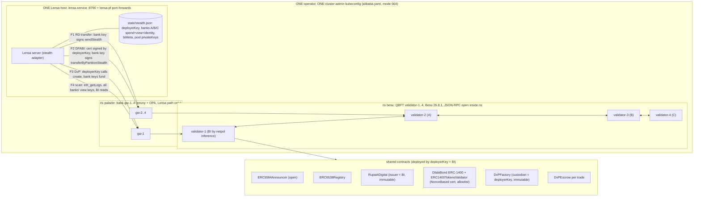
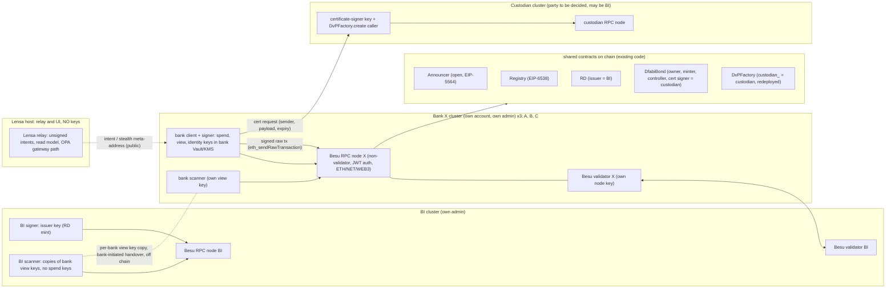

# ARCHITECTURE-stealth

Platform: Besu + stealth-address contracts + client (no Paladin). Date 2026-11-11. Pins: besu@927f572 (`stealth-address/`), frontend@aa6e09b, Besu image 26.8.1 (live ns `besu`), EIP-5564 and EIP-6538 from ethereum/ERCs master (fetched 2026-11-11, both status Final). Read-only research. Line numbers below were read in this session; EIP text is cited by section heading.

Objectives per bank: (a) own validator, (b) self-submit from own stack and keys, (c) no mandatory third party beyond upstream. R1 ACCEPTED (user 2026-11-10: EIP-5564 scope = recipient privacy; amount, token, sender public) with the Lensa view-key GAP. R2 GAP (DFABI certificate). R3 ALIGNED.

## 1. BEFORE (today)

Flows: F1 RD transfer through the announcer, F2 DFABI transfer with certificate, F3 DvP escrow create/fund/settle, F4 scanning.

| Box / arrow | Source |
|---|---|
| 4 validators, one ns, one admin; owner per validator not labelled; netpol hints 1=BI 2=A 3=B 4=C | `kubectl -n besu get sts` live 2026-11-11 (4 sts, 20d); analyst platform-zeto.md row "Besu validator"; genesis extraData carries 4 validator addresses (cm besu-genesis) |
| Besu RPC: ETH,NET,WEB3,QBFT,ADMIN,TXPOOL,DEBUG,TRACE,PERM, host-allowlist `*`, CORS all, auth false, metrics 0.0.0.0, tx-pool-min-gas-price 0, sync-mode FULL, no permissioning keys | live cm `besu-node-validator-1-besu-config` (read 2026-11-11); analyst network.md finding 1 |
| bank-gw-1..4 | `kubectl -n paladin get deploy` (4 x 1/1); analyst platform-zeto.md "OPA gateway" |
| Bank txs to its own gateway, BI txs and reads to gw-1 | `frontend/server/src/adapters/stealth.ts:191-194` (`LENSA_BESU_RPC_BANKS`); lensa.env live: `LENSA_BESU_RPC=127.0.0.1:38545`, `LENSA_BESU_RPC_BANKS` = 3 loopback ports 38546-38548 (closes the earlier UNVERIFIED) |
| Lensa holds every key; BI wallet = deployerKey | `stealth.ts:27` ("deployer plays BI: issuer, custodian, certificate signer"), `:113` (`new Wallet(state.deployerKey)`), `:116-117` (view-key holders for all banks, biKeys), `:348-349` (bank wallets from pool privateKey) |
| Key NAMES in state | `state/stealth.json`: `deployerKey`; `banks.{A,B,C}.{spendKey,viewKey,metaAddress,identityKey}`; `biMeta.{spendKey,viewKey,metaAddress}`; `pool.<pair>[].{stealthAddress,privateKey,used}` (names only) |
| F2 certificate by deployerKey | `stealth.ts:390` (transfer cert), `:362-363` (settle, refund certs), `:365` (fund cert), `:364` (`asBi.factory.create`) |
| F1 `sendStealth` announces in same tx | `src/RupiahDigital.sol:52-63,67-84` |
| Announcer open, no storage | `src/ERC5564Announcer.sol:4-18` |
| `DvPFactory.create` only custodian, custodian immutable | `src/DvPFactory.sol:14,30-31` |
| DvP settle atomic, before expiry; cancel by anyone after expiry; bond refund needs a still-valid cert | `src/DvPEscrow.sol:103-119` (settle), `:124-142` (cancel), `:131-136` (BondRefundFailed), `:90-96` (cert lengths/expiry) |
| DFABI setup: cert NonceBased + allowlist with only custodian; every `transferByPartitionStealth` needs a cert | `docs/architecture-brief.md:456-461`; `ts/chain.ts:47-49`; `ERC1400TokensValidator.sol:355,1301,1370` |
| BI and custodian hold bank view keys; handover of view keys "not in code" | `docs/architecture-brief.md:59,119,207` (S1); `ts/memo.ts:8-9` ("BI holds that view key too") |
| Scanning by Lensa for all banks | `stealth.ts:167,200,237,448`; `ts/stealth.ts:58-80` (`scan`, `scanView`, `scanAll`) |
| Announcer/registry are our own deployment, not the canonical addresses | `state/stealth.json` `deployed.announcer`/`registry` vs EIP-5564 and EIP-6538 "Deployment Method" (0x5564..., 0x6538...) |

## 2. AFTER (target)

Rule: only EIP-5564/6538 as written, documented Besu features, standard key custody, and the project contracts as they are. No new contract design; only role holders move.

| Box / arrow / setting | AFTER | Citation |
|---|---|---|
| Bank validator | Each bank runs its own Besu validator with a node key it generated; validator set rotated by `qbft_proposeValidatorVote` (add new address true, remove old false); needs a majority of existing validators. n=4 tolerates 1 down; >= 4 recommended in production | docs.besu-eth.org/private-networks/how-to/configure/consensus/qbft "Add and remove validators"; .../concepts/poa "Liveness" (context7 /websites/besu-eth, unversioned; image 26.8.1) |
| Node key custody | `--node-private-key-file` (file is not encrypted) or `--security-module` plugin; key lives in the bank's cluster only | docs.besu-eth.org/public-networks/concepts/node-keys; .../reference/options "node-private-key-file" |
| Joining node | Bank node syncs FULL (live uses FULL) or SNAP if peers enable `--snapsync-server-enabled`; bootnodes or static-nodes | docs.besu-eth.org/private-networks/get-started/start-node ("Sync nodes BFT"); live `static-nodes-file` |
| Bank RPC node | Separate non-validator node per org; validator exposes only p2p. Design choice; docs show validators plus a non-validator RPC node as the standard topology | docs.besu-eth.org/private-networks/tutorials/quickstart ("four validators, one non-validator RPC node", step "Add a non-validator node") |
| RPC auth + API surface | `rpc-http-authentication-enabled=true` + JWT `permissions` (e.g. `eth:*`, `net:*`, `web3:*`); `rpc-http-api` default ETH,NET,WEB3; drop ADMIN/DEBUG/TRACE/PERM, CORS, `host-allowlist=*`; metrics host not 0.0.0.0. Allowlist is not authentication | docs.besu-eth.org/public-networks/how-to/use-besu-api/authenticate ("JSON-RPC permissions"); .../reference/options; start-node caution box |
| Self-submit | Bank signs with its own key and sends `eth_sendRawTransaction` to its own RPC node. Besu has no account management and no `eth_sendTransaction`; use a wallet or Web3Signer | docs.besu-eth.org/public-networks/how-to/use-besu-api ("Account management"); .../how-to/send-transactions ("Use wallets for key management") |
| Bank keys | Each bank holds its own spending, viewing, identity keys. Spending key is needed in the bank client to derive the stealth key; see hard limit 6 | EIP-5564 Specification "Definitions" (spending key, viewing key), "Private key derivation" |
| Bank scanner | Own client with own viewing key reads `Announcement` logs from own RPC node; view tag filter first | EIP-5564 "Parsing" and "Parsing considerations" (view tag skips ~255/256); `ts/stealth.ts:58,71` (`scan`, `scanView`) |
| Announcer, registry | Singletons, open; no role to move. Own deployment stays (address differs from the canonical one) | EIP-5564 Specification (singleton, "MUST be singleton ... one instance per chain"), "Deployment Method"; `src/ERC5564Announcer.sol:4-5`; EIP-6538 Specification |
| RD | Issuer stays BI (immutable). RD transfer and DvP RD leg need no custodian | `src/RupiahDigital.sol:21,24,33-35`; `docs/architecture-brief.md:12` |
| Custodian role | Not required to be BI. Existing roles that move: DfabiBond `owner` (OZ Ownable `transferOwnership`), `onlyMinter` holder, controllers (`setControllers`, onlyOwner), certificate signer (`addCertificateSigner`/`removeCertificateSigner`, callable by token, owner, controller or an existing signer), and `DvPFactory.custodian_` (immutable, so deploy a new factory instance; old escrows keep working) | `ERC1400.sol:31,155-157,745`; `ERC1400TokensValidator.sol:156-163,219`; `roles/CertificateSignerRole.sol` (`addCertificateSigner`); `DvPFactory.sol:14-18,30-31`; `DvPEscrow.sol:91-96` |
| Certificate flow | Custodian signs per sender and payload (domain separator, msgSender, token, calldata minus last 160 bytes, expiry, nonce); valid for any registered signer; each transfer consumes the sender's nonce | `ERC1400TokensValidator.sol:1301-1370`; `src/DfabiBond.sol:12-14` |
| BI "see all" | BI scanner holds a copy of each bank's viewing key (not spend keys) given by the bank off chain; scans in BI cluster with `scanView` (needs viewing key plus spending public key from the meta-address). This is project design; EIP-5564 has no auditor mechanism | `docs/architecture-brief.md:59,119`; `ts/stealth.ts:71-80`; EIP-5564 "Definitions" |
| BI detective check | BI compares the viewing public key inside each bank's registered meta-address (EIP-6538 `stealthMetaAddressOf`, event `StealthMetaAddressSet`) with the copy it holds | EIP-6538 Specification (registry interface, `registerKeys`); EIP-5564 "Stealth meta-address format" |
| Lensa | Relay and read model: builds unsigned intents from public meta-addresses, forwards signed txs and cert requests, serves UI; holds no spending, viewing, identity, certificate or deployer key | DELTA 1; `stealth.ts:113-118,348-349` (what to remove) |
| Permissioning | Optional local nodes allowlist (`perm_addNodesToAllowlist`, per node file). Accounts allowlist does not fit stealth (see hard limit 7) | docs.besu-eth.org/private-networks/how-to/use-local-permissioning; .../tutorials/permissioning |
| Per-bank credentials | One kubeconfig and one basic-auth secret today; AFTER one admin domain per org | analyst platform-zeto.md rows "Key custody", "Ingress", "kubeconfig / Lensa host" |

### Hard limits (cannot be removed with the allowed building blocks)

1. Amount, token and sender address stay public: EIP-5564 covers recipient privacy only (Motivation; metadata bytes 26-57 carry the amount). Accepted by the user 2026-11-10.
2. BI "see all" is project design, not upstream. The viewing key (EIP-5564 "Definitions") lets its holder recognise payments to a recipient, nothing more. Nothing on chain forces a bank to hand it over or keep it current. A bank can call `registerKeys` again (EIP-6538) with a new viewing key and future receives become invisible to BI. The BI check in section 2 is detective only. R1 stays ACCEPTED with this GAP: "BI sees all" holds only for banks whose current viewing key BI holds. BI's scanner is a new concentration of linkage power; keep it in BI's own cluster and Vault.
3. R1 says only BI, sender and receiver see a transaction. Brief assumption 1 gives the custodian the banks' viewing keys too (`architecture-brief.md:59`). If custodian is not BI this is a fourth viewer. Options for the user: custodian = BI (no extra viewer, R2 GAP stays on BI), or custodian without viewing keys (it then sees only public data plus the cert request; checking the receiver's KYC then needs the sender to disclose the ephemeral key, which is new protocol, not in project code).
4. DFABI transfers always need an online certificate signer (invariant `architecture-brief.md:461`). Online at: bond transfer, bond funding of an escrow, `DvPFactory.create`. Not online at: RD transfer, `settle()`, `cancel()` (certs are stored in the escrow at creation, `DvPEscrow.sol:91-100`). The bond refund in `cancel()` still fails if the stored refund cert has expired (`:131-136`). Moving the signer off BI moves the mandatory third party, it does not remove it. The two existing validator settings that would remove it also remove control: several signers (each bank a signer: any signer can certify any transfer) or `registerTokenSetup` with `CertificateValidation.None` (then the allowlist, which holds only the custodian, blocks every stealth recipient, `ERC1400TokensValidator.sol:394-432`; allowlist off gives an open token). User decision, not a design default.
5. `RupiahDigital.issuer` and `DvPFactory.custodian` are immutable. RD issuer cannot change without a new RD token. The factory can be replaced by a new instance with a new `custodian_`; escrows already created are unaffected.
6. EIP-5564 "Private key derivation" computes the stealth private key from the spending private key plus a hash of the shared secret. A hardware key that cannot export or add scalars cannot sign for stealth addresses; the bank client needs the spending key (or each derived key) in memory. Custody is Vault/KMS-wrapped storage in the bank's own cluster, not HSM-only signing. This is inference from the EIP formula; Besu docs only say use a wallet or Web3Signer for key management.
7. Besu accounts allowlisting lists fixed addresses (`accounts-allowlist` in `permissions_config.toml`); stealth senders are fresh addresses per payment, so it would block them. Inference from the allowlist semantics; not tested. Live network has gas price 0 (`tx-pool-min-gas-price=0`), so stealth addresses need no gas funding (EIP-5564 "Recipients' transaction costs" does not apply).
8. Vendored UniversalToken is archived and unaudited (`src/vendor/universal-token/README.md`); memo key schedule is home-made (`ts/memo.ts:8-9,41-51`, contracts-tokens.md). Out of scope here, unchanged.

## 3. DELTA

| # | What | Source | Objective | Files / objects | Cost |
|---|---|---|---|---|---|
| 1 | Per-bank key custody; Lensa becomes a relay without keys. Move spend, view, identity keys and pool privateKeys of A, B, C into bank-owned signer/Vault; BI deployer and issuer keys into BI Vault; Lensa sends unsigned intents, bank client signs and submits; remove key fields from state | `stealth.ts:27,113-118,348-349,362-390`; `state/stealth.json` key names; EIP-5564 "Definitions"; Besu "Account management" | (b), R1 Lensa GAP | `frontend/server/state/stealth.json`, `server/src/adapters/stealth.ts` (split into intent builder and bank-side signer), new bank signer service per bank, `lensa.env` | L |
| 2 | Bank-run scanner with own viewing key; Lensa read model fed by bank scanners, not by holding view keys | EIP-5564 "Parsing"; `stealth.ts:167,200,237,448`; `ts/stealth.ts:58-80` | (b), R1 | bank client scan job per bank, Lensa read API | M |
| 3 | BI scanner in BI cluster: bank-initiated viewing-key handover (view only, no spend key), registry compare job (viewing pubkey in `stealthMetaAddressOf` vs held copy) | `architecture-brief.md:59,119,207`; EIP-6538 Specification; hard limit 2 | R1 "BI see all" (detective) | BI Vault entry per bank, scan + compare job, alert on `StealthMetaAddressSet` change | M |
| 4 | Custodian split from BI (user picks the party; may stay BI). New certificate-signer key in its own Vault; `addCertificateSigner(new)`, `transferOwnership`, `setControllers`, minter; deploy new `DvPFactory(custodian_)`; retire old signer with `removeCertificateSigner` | `DvPFactory.sol:14-18,30-31`; `ERC1400.sol:31,155,745`; `ERC1400TokensValidator.sol:156-163`; `architecture-brief.md:12,50` | (c), R2 GAP moves, R1 viewer count (limit 3) | DfabiBond, validator, new DvPFactory address in `state/stealth.json` `deployed.dvpFactory`, custodian cert service | M |
| 5 | Own validator per bank: bank generates node key, runs Besu in its cluster, validator set rotated by majority vote; label validator ownership | Besu QBFT "Add and remove validators", "Liveness"; node-keys; live 4 sts 2026-11-11 | (a) | `besu-node-validator-N` sts and secret `besu-node-validator-N-keys` move to bank clusters; genesis `extraData` stays (vote on live chain) | L |
| 6 | Per-bank RPC node: non-validator, JWT auth with `eth/net/web3` permissions only, `host-allowlist` set, CORS off, metrics bound to internal; validators p2p only | Besu "authenticate", "options", quickstart topology; live cm | (b), network review finding 1 | new bank RPC sts, `besu-node-validator-N-besu-config` changes, `bank-gw-N` upstream | M |
| 7 | One admin domain per org: per-bank kubeconfig, per-bank credentials, no shared `alibaba.yaml` | platform-zeto.md rows "Key custody", "Ingress", "kubeconfig" | (a), (b) | alibaba.yaml copies, `paladin-basic-auth`, `~/.opa-keys`, `~/.opa-mtls` | M |
| 8 | Retire `deployerKey` as a shared key after items 1 and 4: it keeps only the RD issuer role (immutable, limit 5), so move it into BI Vault as the BI issuer key and strip every other role from it | `RupiahDigital.sol:21,24`; `stealth.ts:27` | (b) | `state/stealth.json` `deployerKey`, BI Vault | S |
| 9 | Optional: node allowlist (`permissions_config.toml`) for known enodes; no accounts allowlist | Besu "use-local-permissioning"; hard limit 7 | (a) hardening | validator/RPC node config | S |

Order: 1 and 2 first (no chain change, Lensa and bank-client work), 4 after the user picks the custodian, 5 and 6 together, 7 alongside 5, 3 after 2, 8 last.

Open for user: custodian party (limit 3 and 4), several-signers or `None` option (limit 4), whether RD may be redeployed to move the issuer (limit 5).

## 4. SOURCES

- besu@927f572 `stealth-address/src/{RupiahDigital,ERC5564Announcer,ERC6538Registry,DvPEscrow,DvPFactory,DfabiBond,InstrumentRegistry}.sol` read 2026-11-11
- besu@927f572 `stealth-address/src/vendor/universal-token/{ERC1400.sol,roles/CertificateSignerRole.sol,extensions/tokenExtensions/ERC1400TokensValidator.sol,README.md}` (Consensys UniversalToken commit 54320c6f, per README) read 2026-11-11
- besu@927f572 `stealth-address/ts/{memo.ts,stealth.ts,chain.ts}`, `stealth-address/docs/architecture-brief.md:11-12,49-60,119,207,456-461` read 2026-11-11
- frontend@aa6e09b `server/src/adapters/stealth.ts` (lines as cited), `server/state/stealth.json` (key names and `deployed` addresses only, no values printed) read 2026-11-11
- https://raw.githubusercontent.com/ethereum/ERCs/master/ERCS/erc-5564.md (last commit touching file 90bed81770, 2026-01-23; Final) fetched 2026-11-11; sections: Motivation, Specification "Definitions", Announcer/metadata, "Stealth meta-address format", "Private key derivation", "Parsing considerations", "Deployment Method", "Security Considerations" (DoS Countermeasures, Recipients' transaction costs)
- https://raw.githubusercontent.com/ethereum/ERCs/master/ERCS/erc-6538.md (last commit touching file 7cd433ae63, 2024-06-25; Final) fetched 2026-11-11; sections: Specification (registry, `registerKeys`, `registerKeysOnBehalf`, events), "Deployment Method", "Security Considerations"
- https://docs.besu-eth.org (context7 /websites/besu-eth, snapshot unversioned, queried 2026-11-11; running image 26.8.1; doc pages may differ from 26.8.1):
  - private-networks/how-to/configure/consensus/qbft "Add and remove validators"
  - private-networks/concepts/poa "Liveness"
  - private-networks/get-started/start-node; private-networks/tutorials/{qbft,quickstart,permissioning}
  - private-networks/how-to/use-local-permissioning
  - public-networks/how-to/use-besu-api (Account management), .../use-besu-api/authenticate, .../send-transactions
  - public-networks/concepts/node-keys; public-networks/reference/options
- Live read-only (KUBECONFIG alibaba.yaml, 2026-11-11): ns besu sts/svc/pvc, cm `besu-node-validator-1-besu-config`, cm `besu-genesis`; ns paladin deploy bank-gw-1..4; `~/.config/lensa/lensa.env` (`LENSA_BESU_RPC`, `LENSA_BESU_RPC_BANKS` values are loopback ports only)
- Analyst reports 2026-11-11 in `agents/analyst/reports/`: platform-stealth.md, platform-zeto.md, matrix.md, contracts-tokens.md, network.md

UNVERIFIED: validator-to-org mapping 1=BI 2=A 3=B 4=C (netpol inference, not labelled); that lensa-pf forwards 38546-38548 target bank-gw-2..4; hard limits 6 and 7 are inferences (EIP formula, allowlist semantics), not tested; Besu docs not pinned to 26.8.1; cost S/M/L are estimates; the EIP-6538 detective check assumes the meta-address layout in EIP-5564 "Stealth meta-address format" (spending pubkey then viewing pubkey) and was not executed.
