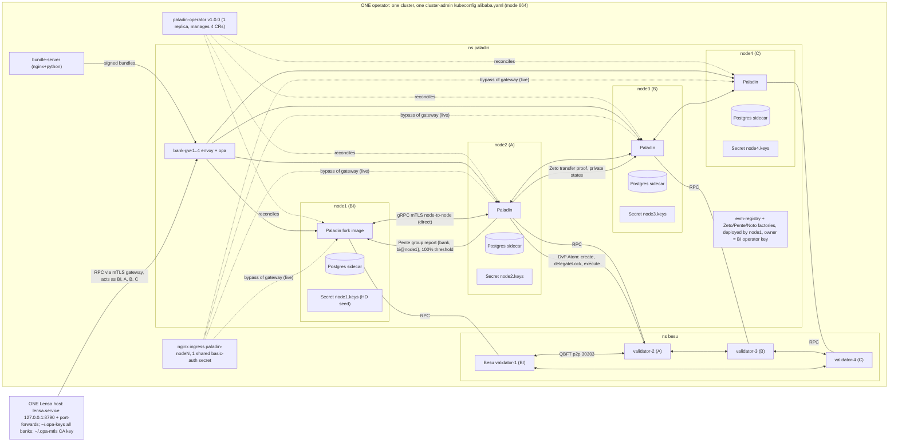
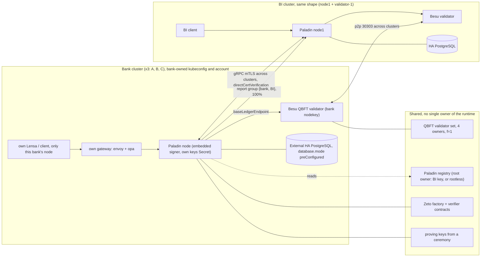
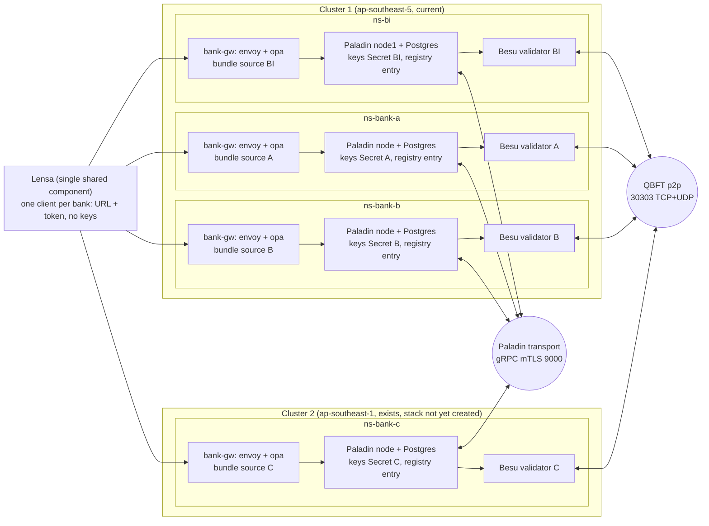

# ARCHITECTURE-zeto

Scope: Zeto_AnonNullifier on Paladin, Besu QBFT base ledger. Repos besu@927f572, frontend@aa6e09b. Upstream: paladin@v1.0.0 (6d4b913), zeto@v0.5.1, Besu docs via context7 `/websites/besu-eth` (site docs.besu-eth.org, unversioned in context7; live image is 26.8.1, so version match is NOT proven). Live reads 2026-11-11, read-only. Rule: AFTER uses only configuration and deployments that upstream documents. Anything that needs new code is listed as a limit, not as a solution.

Objectives: (a) validator, (b) self-submit, (c) third-party; R1 only sender/receiver/BI see the full tx; R2 settlement with BI offline; R3 atomic DvP.

## 1. BEFORE (as it runs today)

| Box / arrow | Source proving it |
|---|---|
| Besu validators 1-4, one ns, image 26.8.1, 20d | `kubectl get sts -n besu` (4 sts, hyperledger/besu:26.8.1); `kubectl get cm besu-genesis -n besu` genesis.json `qbft` {blockperiodseconds 2, epochlength 30000, requesttimeoutseconds 4} |
| Validator N serves Paladin nodeN (1=BI, 2=A, 3=B, 4=C) | live `kubectl get paladin node1 -n paladin` spec.baseLedgerEndpoint = `besu-node-validator-1...:8545`; netpol `besu-node-validator-2-ingress` allows 8545 from `bank-gw node2` and `paladin instance node2` (mapping for 3,4 inferred) |
| Validator p2p inside one ns, static nodes, discovery on | live cm `besu-node-validator-1-besu-config`: static-nodes-file, p2p-port 30303, discovery-enabled true; netpol port 30303 from ns besu only |
| Paladin nodes 1-4, fork image, operator v1.0.0 | `kubectl get sts -n paladin` (paladin-node1..4, image ghcr.io/radityaaa43/paladin@sha256:6f113f38...); `kubectl get deploy paladin-operator -n paladin` image `lfdecentralizedtrust/paladin-operator:v1.0.0` |
| Postgres sidecar per node, 20Gi | live `kubectl get paladin node1` spec.database {mode sidecarPostgres, 20Gi alicloud-essd}; secret `paladin-nodeN-db` |
| Keys: HD wallet from Secret, sign RPC open | live cm `paladin-node1` key `pldconf.paladin.yaml`: wallets signer-1 embedded, keyDerivation bip32, keyStore static file /keystores/signer-1/keys.yaml (lines 435-464 of the data), `disableSignRPC: false` (line 186), `keyStoreSigning: false` (458); secrets `node1.keys`..`node4.keys` |
| Node-to-node mTLS gRPC, self-signed cert-manager certs | live `paladin node1` spec.transports[0].tls {certName paladin-node1-mtls, issuer selfsigned-issuer}; pldconf `clientAuth: true` (line 410); secrets `paladin-nodeN-mtls` |
| Registry + factories deployed by node1, rootless=false | `kubectl get paladinregistry evm-registry -n paladin` (0x99f3...7874); `kubectl get smartcontractdeployment registry -n paladin` spec {from registry.operator, node node1, paramsJSON `[false]`}; owner address itself not read by eth_call |
| Every node registered by BI's key | `kubectl get paladinregistration node2 -n paladin` spec {registryAdminNode node1, registryAdminKey registry.operator, nodeAdminKey registry.node2, transports [grpc]}; 4 registrations PUBLISHED 2 |
| bank-gw-1..4 envoy+opa, bundle-server, bypass ingress | `kubectl get deploy -n paladin`; `kubectl get ingress -n paladin` (4 hosts, 8.215.48.50); `kubectl get netpol -n paladin` has `paladin-rpc-from-ingress-nginx`; besu@927f572 opa/README.md:130, :218 ("live bypass of the gateway") |
| One shared basic-auth secret | `kubectl get secret paladin-basic-auth -n paladin` (1 secret, 4 ingresses; names only) |
| Lensa acts as every party | frontend@aa6e09b server/src/adapters/zeto.ts:34 `LOOKUP` BI/A/B/C -> bi@node1, bankA@node2, bankB@node3, bankC@node4; :270 `createZetoAdapter`; server/src/gateway.ts:21-24 one gateway URL scheme for all nodes |
| Lensa orchestrates both DvP legs from one process | besu@927f572 zeto/src/flows.ts:114-129 `swap` (leg per party, Atom create, delegateLock per party, execute by buyer) |
| Report group {bank, BI}, externalCallsEnabled true | besu@927f572 zeto/src/flows.ts:99; :90-93 `reportTo` -> `pgroup.sendMessage` |
| Zeto prover in each node image, static domain config | live `paladin node1` spec.config.domains.zeto (Zeto_AnonNullifier, forZetoVariant 1, allowSigning true, defaultGasLimit 30000000); fork unmerged PR #1189 (platform report) |
| Zeto flows never call keymgr_sign | grep of `*.ts` in besu and frontend finds `keymgr_sign` only in frontend/server/test/policy-platforms.test.ts |

## 2. AFTER (target, upstream-supported only)

### Settings (each row: setting | upstream citation)

| Setting | Value in AFTER | Upstream citation |
|---|---|---|
| Wallet, embedded | `keyManager.disableSignRPC: true` (Zeto flows do not use it, see section 1). Wallet `signerType: embedded`, `keyDerivation.type: bip32`, keystore `type: filesystem` or `static`, `keyStoreSigning: false` | paladin@v1.0.0:config/pkg/pldconf/keymanager.go:26-30,48-60; config/pkg/pldconf/signer.go:23-24,37-43,45-52; doc-site/docs/administration/configuration.md:9,344 |
| Why `keyStoreSigning false` | HD (BIP32) and ZKP signing need the seed in memory; HSM-only signing cannot serve Zeto | doc-site/docs/architecture/key_management.md:20-35,116-119; signer.go:40 comment |
| Supported key stores | Only `filesystem` (keystorev3) and `static`. HSM, Vault, cloud KMS = bring-your-own signing module plugin | toolkit/go/pkg/signer/signing_module.go:93-94; key_management.md:41-71,73; signingmodules/example/README.md (opened, plugin must be built into the image) |
| Operator wallet field | `secretBackedSigners` (autoHDWallet or preConfigured, bip32 or direct); operator supports ONE signer | operator/api/v1alpha1/paladin_types.go:207-232; operator/internal/controller/paladin_controller.go:1120-1150 |
| DB | `database.mode: preConfigured` (external HA PostgreSQL, DSN with `passwordSecret`); sidecar is dev/test | paladin_types.go:170-185; doc-site/docs/concepts/cloud_native.md:5,21 |
| Own RPC credentials | `rpcAuthorizers` + `rpcServer.authorizers`, one credential set per bank | doc-site/docs/administration/auth.md:88-134 |
| Transport | grpc plugin; `tls.enabled`, `clientAuth true`, `caFile`; `directCertVerification` default true (self-signed certs compared with the registry copy); optional `externalHostname` (the address other clusters dial) | paladin@v1.0.0:transports/grpc/internal/grpctransport/config.go:23-47; config/pkg/pldconf/tlsconfig.go:19-22 |
| Cert source | cert-manager default; custom cert needs CN = node name and published endpoint in SAN | doc-site/docs/administration/certificate_management.md:3-25 |
| Registry entry per node | one `PaladinRegistration` per node: `registry`, `registryAdminNode`, `registryAdminKey`, `node`, `nodeAdminKey`, `transports` | operator/api/v1alpha1/paladinregistration_types.go:28-36; operator/config/samples/core_v1alpha1_paladinregistration_node2.yaml |
| Registry ownership | Root owner = deployer (`rootless=false`, live) so a new node needs BI's root key once. `rootless=true` = anyone registers under root (constructor arg, so a new registry deployment). Child identity `owner` is chosen at registration, so each bank can own its own node identity | solidity/contracts/registry/IdentityRegistry.sol:45-47,67-72,108 |
| Pente report group | `{bank, bi@node1}` per bank; BI in every group; threshold 100% is the upstream limit | domains/pente/src/main/java/io/kaleido/paladin/pente/domain/PenteDomain.java:100-108 |
| Report send needs target reachable | `pgroup_sendMessage` checks registered transport (connectivity) before storing | core/go/internal/groupmgr/manager.go:155-172 |
| QBFT | 4 validators, one per party; any 1 down = 3 of 4 >= 2/3, blocks continue. 4 is the BFT minimum; 4 to 5 tolerate 1 | docs.besu-eth.org/private-networks/concepts/poa ("Liveness", "Minimum number of validators") |
| Add or remove validator | `qbft_proposeValidatorVote` (majority of current validators); or contract selection mode via genesis `transitions` (all nodes stopped for the swap) | docs.besu-eth.org/private-networks/how-to/configure/consensus/qbft; .../add-validators-without-voting |
| Besu peering across clusters | `static-nodes` or `--bootnodes`; if node permissioning is on, the allowlist must contain the bootnodes and BOTH ingress and egress IPs behind a K8s LB/NAT | docs.besu-eth.org/private-networks/how-to/use-local-permissioning |
| Atom execute | any party may call `execute()` once approvals exist; Zeto `delegate` names who may submit | doc-site/docs/architecture/atomic_interop.md:105-110; doc-site/docs/architecture/zeto.md:190 |

### Hard limits (no fix without new Paladin code or a user decision)

| Limit | Citation | Best supported configuration |
|---|---|---|
| Observer role absent: BI cannot be a passive observer of a Zeto tx, event shows `msg.sender` | paladin@v1.0.0:domains/zeto/pkg/constants/constants.go:26-32 (token-type constants only, role absent), paladin#610; zeto@v0.5.1:solidity/contracts/lib/zeto_fungible.sol:399 | BI sees it via the bank's own Pente report `{bank, BI}`; R1 stays PARTIAL; BI offline = reports lost (live test 2026-11-10, besu/zeto/docs/r1-limitation.md) |
| `Atom.cancel()` has no access control | paladin@v1.0.0:solidity/contracts/shared/Atom.sol:102-107 | create, delegateLock, execute in one step (besu/zeto README "DvP findings"); `RestrictedAtom` (besu/noto+pente/contracts/src/RestrictedAtom.sol:219-224) is a user call |
| Notary | n/a: Zeto has no notary role (zeto.md grep for "notary": no hit). Noto notary limit is outside this document | doc-site/docs/architecture/zeto.md |
| Test proving keys (single-party setup) | fork domains/zeto/build.gradle:67; zeto@v0.5.1 README.md:28 requires a ceremony or one trusted party for deployment | accept as PoC limit, or ceremony + verifier redeploy |
| Running fork, Zeto v0.5.1 not in v1.0.0 | paladin@v1.0.0:domains/zeto/build.gradle:36 `zetoVersion = "v0.2.2"` | keep the fork (accepted); rebase when #1189 merges |
| HSM/Vault custody | only `filesystem` and `static` store types in v1.0.0 (signing_module.go:93-94) | bank-owned Secret or encrypted volume on the bank's cluster; HSM needs a plugin = custom code, ask user |
| One signer per node | paladin_controller.go:1120-1150 ("only one signer currently supported") | one wallet per node |
| QBFT liveness if BI validator count stays at 1 of 4 | poa doc: >= 2/3 must run | 4 owners, 4 validators; with 5-7 validators the tolerance grows (6-8 tolerate 2) |

## 2a. Deployment topology (user decision 2026-11-11)

Decision: one namespace = one full stack per bank per platform; only Lensa is shared; BI is a party with its own namespace. Cluster 1 (current, zone ap-southeast-5) hosts BI, A, B; cluster 2 (ap-southeast-1, exists; I did not probe it, see CLUSTER2-FACTS.md) hosts C. Namespace names are illustrative, lead decides. This supersedes the "one cluster per bank" boxes in section 2.

### Namespace must contain (Zeto: prover is in the node image, so no extra component)

| Component | Per namespace | Setting | Upstream citation |
|---|---|---|---|
| Besu validator | 1, own nodekey | `--p2p-host` = public address (default 127.0.0.1; not overridden if `--nat-method=NONE`); `--p2p-port` 30303 TCP; UDP discovery port defaults to p2p-port; peers listed in `static-nodes-file` or `--bootnodes` with public endpoints; permissioning allowlist needs ingress AND egress IPs behind LB/NAT; add validator by `qbft_proposeValidatorVote` (majority of current validators) | Besu docs (context7 `/websites/besu-eth`): public-networks/reference/options (p2p-host, p2p-port, p2p-discovery-port, nat-method, bootnodes, static-nodes-file); private-networks/how-to/configure/bootnodes; .../consensus/qbft "Add and remove validators"; how-to/use-local-permissioning |
| Paladin node | 1 CR `paladin` + own operator | `baseLedgerEndpoint.type: endpoint` (jsonrpc, ws, auth) to own validator; transport `grpc` with `externalHostname` = public endpoint, `tls.enabled`, `clientAuth`, `directCertVerification` (default true), port 9000 (8548/8549 are HTTP/WS RPC, not transport) | paladin@v1.0.0: operator/api/v1alpha1/paladin_types.go:51-52,84-95; transports/grpc/internal/grpctransport/config.go:24-35; config/pkg/pldconf/tlsconfig.go:19-22; doc-site/docs/getting-started/installation-manual.md:433,438-461 |
| Registry entry | 1 `PaladinRegistration` + `PaladinRegistry` CR (existing contract address on cluster 2) | `registry`, `registryAdminNode`, `registryAdminKey`, `node`, `nodeAdminKey`, `transports: [grpc]`; endpoint and issuer cert are published in the registry | operator/api/v1alpha1/paladinregistration_types.go:25-36; installation-manual.md:93-95,491-496; administering_peers.md:245 |
| Key custody | HD seed Secret only here | `keyManager.disableSignRPC: true`; embedded wallet from `secretBackedSigners`; one signer per node | doc-site/docs/administration/configuration.md:344; paladin_types.go:37; paladin_controller.go:1120-1150 |
| Postgres | 1 per node | `database.mode`: `preConfigured` (default) / `sidecarPostgres` / `embeddedSQLite`; `passwordSecret` | paladin_types.go:174-184 |
| Gateway | `bank-gw` envoy + opa | only path to RPC 8548; bundle served from this org's own bundle source (project choice, no upstream citation) | not covered upstream |
| NetworkPolicy | 1 set | ingress to RPC 8548 only from this namespace's gateway pods; 9000 only from the other nodes' egress IPs (`ipBlock`; source IP may be the LB or node IP); Besu 30303 only from the other validators' egress IPs | kubernetes.io/docs/concepts/services-networking/network-policies/ (ipBlock, source IP note, additive rules); administering_peers.md:264-266 |
| Lensa | 0 (outside) | one client per bank: URL + token; node enforces `rpcAuthorizers` + `rpcServer.authorizers`; Lensa holds no key | doc-site/docs/administration/auth.md:110-134; configuration.md:27,655-674 |

### Cross-cluster limits

- Operator is namespace-scoped: it caches and watches only `WATCH_NAMESPACE` (default `default`), set from the pod's own namespace by the chart. One operator and one CR set per namespace; CRs select domains and registries by labels "in a namespace". Source: operator/cmd/main.go:98,108,211-221; operator/charts/paladin-operator/templates/operator/deployment.yaml:51-54; paladin_types.go:112.
- `PaladinRegistration` resolves `registryAdminNode`, `node` and the `PaladinRegistry` CR in its own namespace. With a non-rootless registry (live) only BI's key is root owner, so a bank cannot run its own registration CR without BI's key in its namespace. Split flow across namespaces: not found upstream. Options: rootless registry (user decision) or BI signs root entries. Source: paladinregistration_controller.go:107,137,238,256; IdentityRegistry.sol:45-47.
- Endpoint reachability: default endpoint is the in-cluster DNS name; `externalHostname` "depends on how ingress is configured, outside the scope of the Paladin project". Cluster 2 needs a public LB or ingress for 9000, and cluster 1 needs the same for BI, A, B. Source: installation-manual.md:461; administering_peers.md:250-262. LB/ingress recipe: not found.
- Besu across NAT: p2p-host and discovery are documented per option; a Kubernetes cross-cluster recipe and latency guidance: not found in the pages queried.
- Placement of Pente/Noto groups: unaffected; a target is `account@node`, and the registry resolves the node to transport and address; no cluster notion. Source: data_and_registry.md:70-76. Multi-cluster upstream guidance is two bullets: install on the primary cluster, reuse contract addresses on others (installation-manual.md:491-496).

### Capacity on cluster 2 (CLUSTER2-FACTS.md, analyst read-only 2026-11-11; I did not probe it) User rule (2026-11-11): every namespace existing on cluster 2 today belongs to other work; bank C goes only into NEW namespaces this project creates (naming: lead); the capacity left over is shared with unrelated workloads and not ours to change; the first write to cluster 2 is a CLUSTER-OP that creates new namespaces only.

Cluster 2 exists: ap-southeast-1 (Singapore), 8 nodes, shared with foreign namespaces. Allocatable 23.4 vCPU / 53 GiB, requested 14.5 vCPU / 23.7 GiB, so about 9 vCPU / 29 GiB free by requests. Bank C for this platform: Besu validator 1 pod (~1 vCPU / 2.4 GiB), Paladin node + Postgres 2 pods (~0.45 vCPU / 1.7 GiB), gateways 2 pods (~0.1 vCPU / 0.3 GiB) = 5 pods, ~1.55 vCPU / 4.4 GiB: fits by requests. Risk is memory, not CPU: actual use is 76-98% on the member nodes, and Besu and Paladin need member nodes (core nodes cap at 15 pods and 6.7 GiB). Sequence: Besu reader node (non-validator, same genesis, enode reachable through an L4 LB for TCP 30303 and UDP discovery; Besu privacy quickstart "Add non-validator node" shows the generic steps), then Paladin + Postgres + registration, then gateways, then the validator vote.

### Cross-region latency

Measured RTT Jakarta to Singapore is about 15 ms (TCP connect to the cluster-2 API server, 3 samples; cluster 1 is 0.5-1.3 ms); assume at most 30 ms pod-to-pod through an LB. QBFT tunables: `blockperiodseconds` (default 1) and `requesttimeoutseconds` (default 1), live genesis 2 s and 4 s (per CLUSTER2-FACTS.md, live `besu-genesis` cm, not re-read by me). Besu docs: a round that misses `requesttimeoutseconds` doubles the next timeout, and ConsenSys ran validators in Sweden, Sydney and North Virginia on 5 s / 10 s (IBFT 2.0 page "Block time"; QBFT page lists the options). The margin, 15-30 ms against 2000/4000 ms, means no change. A WAN validator still counts for liveness: more than 2/3 of validators must be online (poa "Liveness"). Paladin gRPC transport: the config has only `gracefulShutdownTimeout` (default 500 ms), no latency, timeout or keepalive field: transports/grpc/internal/grpctransport/config.go:38-40,46; grep for keepalive in transports, config/pkg and doc-site: not found.

Bank C bring-up, verified against upstream: embedded signer with `static` or `filesystem` keystore plus `disableSignRPC: true` is the no-custom hardening (signing_module.go:93-94; configuration.md:344); a remote or HSM signer is Paladin-side plugin code, out under "no custom Paladin" (key_management.md:41-70 documents the plugin interface only). Node C uses gRPC with `externalHostname` and cert SANs; a shared CA is NOT required with the default `directCertVerification` (certificate compared with the registered copy: config.go:31-35,45); its registration is signed by BI's registry key while the registry is non-rootless.

## 3. DELTA

Cost: S = config/doc, M = one cluster rollout or small app change, L = multi-party migration or app flow redesign.

1. **Per-bank key custody and signing (Lensa stops signing for banks).** What: each bank runs its Paladin node in its own namespace (cluster 1 for BI/A/B, cluster 2 for C); `nodeN.keys` (HD seed) is created and kept only there (embedded wallet, `static`/`filesystem` store); `disableSignRPC: true`; Lensa and the one kubeconfig lose access to bank seeds; rotate the seeds only if the user wants the old shared copies treated as exposed (the keys live on-chain as Zeto owners, so rotation = new identities and token migration). Source: key_management.md:41-71,116-119; keymanager.go:26-30; signer.go:23-24,37-43. Objective: self-submit, third-party. Touches: Secrets `node1..4.keys`, cm `paladin-nodeN` (`disableSignRPC`), CR `paladin node2..4` (`secretBackedSigners`), besu@927f572 zeto/src/flows.ts, frontend@aa6e09b zeto.ts:34. Cost L. Open question for the user: a seed already in a shared Secret cannot be proven private, so moving the Secret is a trust reset, not a copy. HSM/Vault custody needs a plugin (limit above).
2. **Bank-owned namespace (cluster 1 for BI/A/B, cluster 2 for C), kubeconfig and credentials.** Split `alibaba.yaml` (mode 664, cluster-admin) into one kubeconfig per party; per-bank `rpcAuthorizers` credentials replace `paladin-basic-auth`; remove ingress bypass or put it behind the bank's own gateway. Source: auth.md:88-134; besu@927f572 opa/README.md:130,218. Objective: self-submit, third-party. Touches: secret `paladin-basic-auth`, ingress `paladin-nodeN`, netpol `paladin-rpc-from-ingress-nginx`, `~/.opa-keys`, `~/.opa-mtls`. Cost M.
3. **Own Besu validator per bank, in the bank's own namespace (cluster 1 for BI/A/B, cluster 2 for C).** Each bank generates its nodekey, joins via `static-nodes`/bootnodes with its ingress+egress IPs, existing validators vote it in with `qbft_proposeValidatorVote`, then the old in-cluster validator is voted out (one change at a time, never below 3 of 4 up). Paladin `baseLedgerEndpoint` points to the bank's own Besu. Source: Besu poa + qbft + use-local-permissioning docs. Objective: validator. Touches: sts `besu-node-validator-2..4`, cm `besu-genesis`/`besu-peers`/`besu-node-validator-N-besu-config`, netpol `besu-node-validator-N-ingress` (30303 only from ns besu today), CR `paladin node2..4` `baseLedgerEndpoint`. Cost L. Version note: Besu docs not pinned to 26.8.1.
4. **Cross-cluster Paladin transport.** Set `externalHostname` per node, keep `directCertVerification`, publish each bank's cert through its own registration, open 9000 between clusters (today the node-to-node path is intra-cluster). Source: grpctransport/config.go:23-47; certificate_management.md:3-25; administering_peers.md (not opened beyond headings). Objective: validator, third-party. Touches: CR `paladin nodeN` transports, secrets `paladin-nodeN-mtls`, `PaladinRegistration nodeN`. Cost M.
5. **Registry ownership.** Decide: (a) keep BI as root owner and register each bank node identity with the bank's own address as owner (BI is needed once per new node), or (b) deploy a rootless registry (constructor arg, new deployment, all four `PaladinRegistration` redone). Source: IdentityRegistry.sol:45-47,67-72,108. Objective: third-party. Touches: `smartcontractdeployment registry`, `paladinregistry evm-registry`, `paladinregistration node1..4`. Cost M for (a), L for (b). Needs the user (scope).
6. **Bank-owned database.** Replace `sidecarPostgres` with `preConfigured` external HA PostgreSQL per bank; migrate 20Gi data. Source: paladin_types.go:170-185; cloud_native.md:5,21. Objective: validator (a bank node that survives its pod loss). Touches: CR `paladin nodeN` spec.database, secrets `paladin-nodeN-db`. Cost M. Postgres backup and restore not opened.
7. **Bank-side Lensa or client; cross-bank DvP coordination.** Each bank runs a client that talks only to its own node. A DvP needs lockId/calldata exchange and the Atom address across banks (atomic_interop.md:46-117 describes setup, approve, execute; any party can execute). Today one process drives both legs (flows.ts:114-129). Messaging between banks can use Paladin's own group messages; the choreography is project application code, not a Paladin change. Objective: self-submit, R3. Touches: besu@927f572 zeto/src/flows.ts, frontend@aa6e09b zeto.ts, gateway.ts:21-24. Cost L. Needs the user (flow redesign).
8. **Report groups stay `{bank, BI}`, confirm BI reachability SLO and drop unused flag.** No config removes the BI dependency (observer role absent). Set `externalCallsEnabled` false for report-only groups (upstream default false). Source: PenteDomain.java:100-108,697 (697 from the contracts review, not re-opened); manager.go:155-172. Objective: R1 (partial), R2 (reports lost with BI down). Touches: besu@927f572 zeto/src/flows.ts:99. Cost S.
9. **Atom.cancel mitigation.** Keep create, delegate, execute in one atomic client step (bank-side per item 7 raises the race window because two banks now act). RestrictedAtom stays a user decision. Source: Atom.sol:102-107. Objective: R3. Touches: flows.ts:114-129. Cost S (mitigation) / M (RestrictedAtom).
10. **Proving keys ceremony.** Generate keys with a documented multi-party ceremony, redeploy verifiers and Zeto tokens (RD, DFABI). Source: zeto@v0.5.1 README.md:28; fork build.gradle:67. Objective: trust of Zeto proofs (no objective in the list; risk). Touches: verifier `smartcontractdeployment zeto-g16-*`, fork image zkp dir. Cost L, user decision (PoC limit may be accepted).

11. **Cluster 2 provisioning for bank C and cross-cluster endpoints (validator p2p, Paladin 9000, gateway).** Provision cluster 2 (not probed); create ns-bank-c with its own operator (`WATCH_NAMESPACE`), Registry CR on the existing contract address, LB or ingress for Besu 30303 TCP+UDP, Paladin 9000 and the gateway; allowlist ingress and egress IPs of all four validators; registration needs BI's key or a rootless registry (item 5). Source: section 2a limits; installation-manual.md:461,491-496; Besu options and use-local-permissioning docs. Objective: validator, third-party. Touches: new cluster, `paladin`, `paladinregistry`, `paladinregistration` CRs in ns-bank-c, netpol, LB Services. Cost L.

Order: 2, 1 (decouples keys), 11 (before 4 and 3 for bank C), 4, 3, 6, 5, 7, 8, 9; 10 any time.

## 4. SOURCES

Date fetched/read for every line: 2026-11-11.

- paladin@v1.0.0 (6d4b913, `git describe` = v1.0.0), local clone in scratchpad/upstream/paladin: doc-site/docs/{concepts/cloud_native.md, architecture/{key_management,atomic_interop,zeto,data_and_registry}.md, administration/{configuration,auth,certificate_management}.md}; config/pkg/pldconf/{keymanager,signer,tlsconfig}.go; toolkit/go/pkg/signer/signing_module.go; transports/grpc/internal/grpctransport/config.go; operator/api/v1alpha1/{paladin,paladinregistration}_types.go; operator/internal/controller/paladin_controller.go; operator/config/samples/core_v1alpha1_paladinregistration_node{1_admin,2}.yaml; solidity/contracts/registry/IdentityRegistry.sol; solidity/contracts/shared/Atom.sol; domains/pente/.../PenteDomain.java; domains/zeto/{build.gradle,pkg/constants/constants.go}; core/go/internal/groupmgr/manager.go; signingmodules/example/README.md.
- zeto@v0.5.1 (`git describe` = v0.5.1), scratchpad/upstream/zeto: solidity/contracts/lib/zeto_fungible.sol:399; README.md:28.
- Besu docs, context7 `/websites/besu-eth` (unversioned): private-networks/concepts/poa, how-to/configure/consensus/qbft, how-to/configure/consensus/add-validators-without-voting, how-to/use-local-permissioning. Live image 26.8.1.
- Added 2026-11-11 for section 2a (pin paladin@v1.0.0 6d4b913; Besu docs unversioned): doc-site/docs/getting-started/installation-manual.md:93-95,433-461,491-496; doc-site/docs/administration/{administering_peers.md:245-266,auth.md:110-134,configuration.md:27,344,655-674}; doc-site/docs/architecture/data_and_registry.md:70-76; operator/cmd/main.go:98,108,211-221; operator/charts/paladin-operator/templates/operator/deployment.yaml:51-54; operator/internal/controller/paladinregistration_controller.go:107,137,238,256; operator/api/v1alpha1/paladin_types.go:37,51-52,84-95,112,174-184. Besu docs: public-networks/reference/options (p2p-host, p2p-port, p2p-discovery-port, nat-method, bootnodes, static-nodes-file), private-networks/how-to/configure/bootnodes, public-networks/concepts/ipv6-dual-stack (P2P options table). Kubernetes: kubernetes.io/docs/concepts/services-networking/network-policies/ (fetched 2026-11-11, unversioned page). Also 2026-11-11: Besu private-networks/how-to/configure/consensus/qbft (genesis options), .../consensus/ibft ("Block time"), tutorials/quickstart-with-privacy ("Add non-validator node"); paladin transports/grpc/internal/grpctransport/config.go:31-46; scratchpad/design/CLUSTER2-FACTS.md (analyst read-only, not re-read live by me). Not opened: Besu how-to/connect/specify-nat and configure-ports pages (only referenced from options).
- Project: besu@927f572 zeto/src/flows.ts, opa/README.md; frontend@aa6e09b server/src/adapters/zeto.ts, server/src/gateway.ts; analyst reports 2026-11-11-{platform-zeto,matrix,contracts-tokens,network,opa}.md (re-checked above where cited).
- Live read-only (KUBECONFIG alibaba.yaml, secret names only): `kubectl get` sts, deploy, ingress, netpol, secret, cm, paladin, paladinregistry, paladinregistration, smartcontractdeployment in ns besu and paladin.
- Not opened: paladin administration/administering_peers.md body, auth.md after line 134, architecture/overview.md; Postgres HA operator specifics; Besu 26.8.1 version-specific docs; owner address of the registry (no eth_call); live node3/node4 specs beyond names; fork diff vs v1.0.0.
